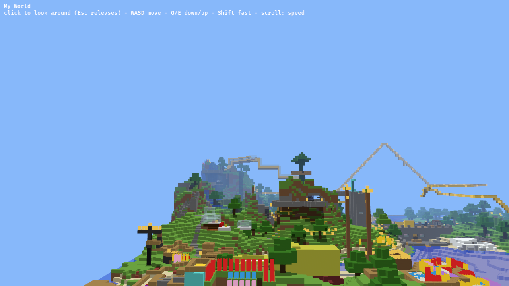
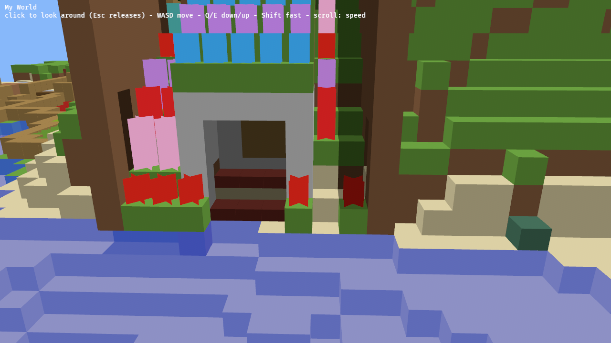

---
▸ 2026-10-29T03:58:14Z [delta:Start investigation for yak mem-0908]

moved: hairy -> shaving

---
▸ 2026-10-29T03:58:14Z [delta:Start investigation for yak mem-0908]

## Plan (low-effort first cut)

- **Stack:** Bevy 0.20, which supports `wasm32-unknown-unknown` with WebGL2 and needs `wasm-bindgen` output. The built-in `FreeCamera` controller handles fly controls (WASD/QE, mouse look, scroll for speed).
- **Data:** `mcpe-world` reads the real PE world in the browser. For now the world's files are embedded in the binary by `build.rs`, about 1.6 MB.
- **Meshing:** one mesh per chunk column, with face culling against opaque neighbours.
  - Shapes: full cubes, partial-height boxes (slabs, carpets, rails, snow), and cross quads for plants.
  - Water and glass go in a separate alpha-blended mesh.
- **Look:** flat per-block colours with per-face shading and fog. No textures yet, which sidesteps the licensing question.

[viewer-drive](mem-0174/viewer-drive.js)

---
▸ 2026-10-29T04:48:57Z [delta:Start investigation for yak mem-0908]

Landed `547588c` (local `main`): `crates/memcraft-viewer`, a basic fly-through that runs natively and in the browser.

## Decisions

- **Bevy 0.19.1, not 0.20.** 0.20 requires Rust 1.97.1 and the local toolchain is 1.95. Bevy 0.19 already ships `FreeCamera` (WASD/QE, mouse look, scroll for speed) and WebGL2 support.
- **The world is embedded at build time** via `build.rs`, about 1.6 MB, and read with `mcpe-world` inside the wasm. There's no file loading or fetch yet.
- **Rendering:** unlit vertex colours, per-face shade, a darker tint below the topmost opaque block, linear fog, and `Tonemapping::None`. Shapes are cube / partial box / crossed quads, plus a translucent pass. That's 294,689 quads for the whole world.
- **Trimmed Bevy features** (no glTF, post-processing, gizmos or LUTs) and a `wasm-release` profile (opt-s, fat LTO, stripped). The wasm is 26 MB, 7.6 MB gzipped. `wasm-opt` isn't installed and would shrink it further.

## Evidence

- `cargo test` passes. New tests: every block id in My World has a colour, and face culling keeps column (8, 8) between 256 and 20k quads. Clippy is clean.
- The native release build runs on Metal (M4 Max). The log shows "meshed 256 columns, 294689 quads".
- The browser build loaded in headless Chrome (SwiftShader WebGL2). It started drawing about 3 s after load, with no errors.
  - `viewer-start.png`: the start view at the saved player position (the house).
  - `viewer-wide.png`: the view after flying back 6 s and up 4 s using real key presses. It shows the island, the roller coaster, builds, water and fog. Driver script: `viewer-drive.js`.

## Not done / next

- Textures (still undecided: an open pack or user-supplied).
- Stairs and fences are drawn as plain boxes; there's no smooth lighting or AO; no in-page world picker.

---
▸ 2026-10-29T04:48:57Z [delta:Start investigation for yak mem-0908]

moved: shaving -> shorn
