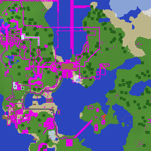

Goal: This repo has some old Minecraft PE worlds in it, that we want to resurrect in a form where we can revisit it for old time's sake. Some goals:
- Find an existing implementation to crib from if possible.
- Web-based would be preferable, but perfectly fine if we have to do something like compile Rust -> WASM.
- Simple, fast, easy to share (hence web-based if at all practical).
- A ~full implementation would be good, but simplified (even read/explore only) is acceptable if that's easier, or just as a starting point.
- Able to load existing Minecraft PE worlds. Full Minecraft desktop worlds unnecessary (but fine if it's easy enough). There's an example to test in [My World]("worlds/My World").
- All else being equal, a cross-compiled Rust implementation would be preferable. But Typescript would be fine if that's easier.

---
▸ 2026-10-29T01:15:52Z [delta:ksQQIbEyLlBTSq-NouBlgdxzIZLOADWc65IBxBCA]

moved: hairy -> shaving

---
▸ 2026-10-29T01:19:24Z [delta:ksQQIbEyLlBTSq-NouBlgdxzIZLOADWc65IBxBCA]

## Findings: what "My World" actually is

The world is from MCPE around 0.15/0.16 (mid-2016). It sits in the middle of a format migration.

- Storage: Mojang's LevelDB fork. Blocks use zlib (id 2); the log is uncompressed. `StorageVersion` = 4. The LOG dates to 2016-06-12.
- `level.dat`: an 8-byte header, then little-endian NBT. It's an old **limited (256×256) world**: chunks 0..15 × 0..15, 65,536 columns, spawn (128, 64, 128).
- Terrain uses **two block formats in the same DB**:
  - 54 chunks of legacy `LegacyTerrain` (tag `0x30`, 83,200 B: 16×16×128 ids + data/sky/block-light nibbles + heightmap + biomes; chunk version 2)
  - 202 chunks of v0 `SubChunkPrefix` (tag `0x2f`, 6,145 B: version byte + 4096 ids + 2048 data nibbles; chunk version 4; y 0..6)
  - none of the chunks overlap
- Also present: `Data2D` (`0x2d`), block entities (`0x31`), entities (`0x32`), `~local_player` + 2 players, villages, portals, BiomeData.
- Block ids are pre-flattening numeric ids, essentially Java 1.12 numbering.

## Proof of decode

A throwaway Rust probe (`rusty-leveldb` + a `flate2` zlib compressor, run on a temp copy of the world, in `/tmp/mcprobe`) reads every chunk in both formats. The top-down render (attached) stitches both formats together seamlessly. Magenta is only my incomplete colour table (rails, fences, gold blocks, wool…): lots of builds.

Takeaway: parsing this world is small and well understood. The real work is rendering, textures and gameplay.

Note: `worlds/` exists only untracked in the main checkout (`/Users/joel/src/rs/memcraft/worlds`). It isn't committed, so agent clones don't see it.

---
▸ 2026-10-29T01:19:24Z [delta:ksQQIbEyLlBTSq-NouBlgdxzIZLOADWc65IBxBCA]

## Landscape of existing implementations

**Playing it in actual old MCPE code: not viable for this world**

- NBCraft / ReMinecraftPE (C++, 0.1.3 decompilation, has a WebGL/emscripten build) and MCPEweb (0.6.1 in WASM) both predate LevelDB. They use `chunks.dat`, so they can't load this world without a down-converter. They also need original APKs/assets, and MCPEweb's provenance is legally murky.

**Browser clients that load worlds**

- zardoy `minecraft-web-client` (mcraft.fun; TS, MIT, Three.js + an in-browser flying-squid server). It loads **Java** worlds (zip/folder/URL) for versions 1.8–1.21 and is playable with editing. It does not load Bedrock.
- zardoy `minecraft-renderer` (Three.js with a Rust/WASM mesher). It's a renderer library only.
- BlueMap / Arcus92 web viewer: Java-only map viewers that need a pre-export step.

**Converters**

- Chunker (HiveGames, MIT, Java) converts Bedrock to Java. It officially supports Bedrock 1.12+. Whether it handles 0.15-era `LegacyTerrain` / v0 subchunks is untested.

**Rust parsing**

- `bedrock-world` crate (MIT/Apache, 2026). It explicitly parses LevelDB-era `LegacyTerrain` and legacy subchunks, but it's young (about 600 downloads) and pulls in tokio and rayon. It's handy as a reference, but our own decoder is about 100 lines.
- `rusty-leveldb` is pure Rust (should build for wasm). It needs a zlib compressor registered under id 2.

**Rust voxel engines on wasm/wgpu** (minecrust, woxel, …) are toy engines with procedural worlds. They're useful as scaffolding at best.

---
▸ 2026-10-29T01:19:40Z [delta:ksQQIbEyLlBTSq-NouBlgdxzIZLOADWc65IBxBCA]

asked: needs human

## Decision needed: which route?

**A. Convert, then play in mcraft.fun (fastest to playable).** Convert the world to a Java Anvil world and load it via `mcraft.fun/?map=<zip url>`. We could use Chunker if it handles 0.15-era chunks, or write our own small Rust converter, which is easy because the block ids are already Java-1.12 numbering. You get a full walk/build client in TypeScript that we don't maintain, and it's shareable by URL. Downsides: it isn't "ours", and the client looks like Java Edition, not PE.

**B. Our own Rust → WASM explorer.** `rusty-leveldb` + our decoder + a wgpu/WebGL mesher. Start as a read-only fly-through and grow toward walk/edit. This matches the Rust preference and we fully own it. It's more work (meshing, non-cube blocks, textures). Mojang textures can't be redistributed, so we'd need an openly licensed pack, or the user supplies one.

**C. Hybrid.** Rust/WASM loader feeding zardoy's `minecraft-renderer` (Three.js). A mid-cost option, but the renderer is young and expects Java-style block states.

**Lean:** spike A first (hours, not days) to get the world on screen and validate the data. Then decide whether B is worth building as the long-lived project. A's converter code (decoder + id mapping) carries straight into B.

---
▸ 2026-10-29T01:32:17Z [Joel Webber]

Wow, that was fast. Let's try getting it converted first and see how it works on mcraft.fun. Then we can see how complete mcraft.fun is, and whether we should just stick with that, or need to build anything else.

---
▸ 2026-10-29T01:33:56Z [delta:Start investigation for yak mem-0908]

joelgwebber (in Delta chat): "Good work. Let's plow ahead!" — taken as approval of the lean: spike route A (own Rust converter → Java 1.12 Anvil → mcraft.fun), keeping the decoder reusable for route B.

---
▸ 2026-10-29T01:33:57Z [delta:Start investigation for yak mem-0908]

picked up

Picking up: filing implementation yaks for the route-A spike and starting on them.

---
▸ 2026-10-29T02:36:27Z [delta:Start investigation for yak mem-0908]

## Route A spike complete

My World is playable in the browser via mcraft.fun. Done: mem-0d8e (decoder), mem-0f2a (converter), mem-ef1e (in-client verification with screenshots).

Commits on local `main`, not pushed: `331cc2e`, `632d2ff`, `c84f23a`, `d535fa5`, plus a README commit.

Open follow-ups:

- mem-f434: hosting / a share link. Needs a decision on making the world public.
- mem-dd32: whether to build our own Rust/WASM explorer (route B). Needs a decision on texture source and scope.
- mem-67f9: convert item frames, entities, piston heads (low priority).

---
▸ 2026-10-29T12:08:49Z [delta:Start investigation for yak mem-0908]

## Closed

Both routes are working and landed on origin/main (`88fe82b..499b3d1`):

- **Route A** (mem-0d8e, mem-0f2a, mem-ef1e): `mcpe-world` decoder, plus `mcpe2java` to convert to Java 1.12.2, verified playable in mcraft.fun.
- **Route B** (mem-dd32 → mem-0174): `memcraft-viewer`, a Bevy fly-through that reads the PE world directly, native and WebGL2.

Joel tested both locally. Open follow-ups are top-level yaks: mem-f434, mem-7aba, mem-99d0, mem-f13a, mem-67f9.

---
▸ 2026-10-29T12:08:49Z [delta:Start investigation for yak mem-0908]

moved: shaving -> shorn
