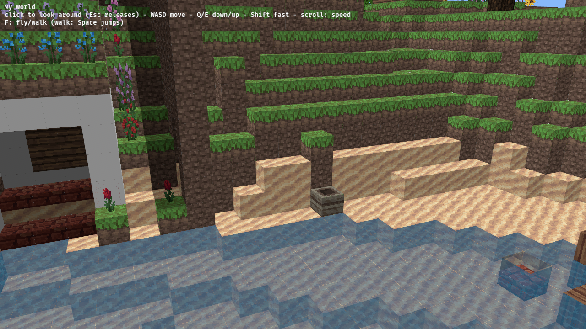
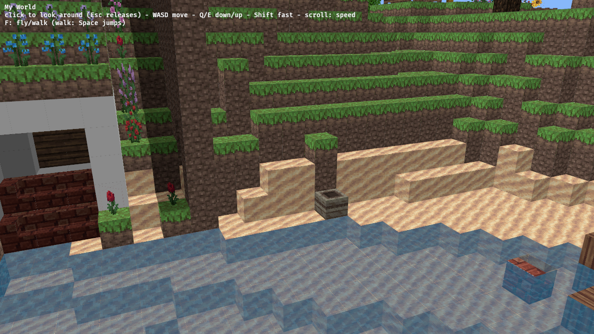

Prerequisite for interactions: today doors are drawn as full cubes, stairs and signs as half slabs, and physics treats them all as whole blocks, so an open door would look and feel exactly like a closed one.

## Scope

- A box-list shape in `blocks.rs`/`mesh.rs` (one or more axis-aligned boxes per block, from id and data): doors (open/closed, hinge, facing), trapdoors, fence gates, fences and walls, glass panes and iron bars (connecting to neighbours), stairs, standing and wall signs, ladders on their wall, levers/buttons.
- Physics (`physics.rs` `Solids`) collides with the same boxes, so open doors and gates are passable and fences are 1.5 high.
- PE 0.16 data values.

## Evidence

- Unit tests: box lists for a closed/open door and a stairs block; a walk test through an open door.
- drive.js screenshots of a door, fence and stairs in the sample world, before and after.

---
▸ 2026-11-01T01:59:30Z [herd]
kind: move
from: hairy
to: shaving
---

moved: hairy -> shaving

---
▸ 2026-11-01T01:59:30Z [herd]

Claim: worker `shape-1` (Delta subthread), base `8fc3164`.

- Scope: `blocks.rs` (a box-list shape and the blocks that use it), `mesh.rs` (meshing boxes), `physics.rs` (`fill`/`Solids` collide with the same boxes; may change `Solids`' representation).
- Out of scope: `world.rs`, `controls.rs`, any input or UI, interactions (toggling doors is `mem-1457`).
- Evidence: unit tests named in the yak, existing physics tests still pass, drive.js screenshots of a door, fence and stairs before/after, quad count and wasm size before/after.
- Judge: yakherd at landing.

---
▸ 2026-11-01T02:00:25Z [shape-1]

Started 2026-11-01T02:00:21Z (`date -u`).

`yaks path mem-12d5`: `/home/user/.local/share/yaks/farms/memcraft/.yaks/mem/yaks/mem-12d5.md`. Worktree `/home/user/memcraft-3`, base `8fc3164`.

---
▸ 2026-11-01T02:24:56Z [shape-1]

Progress (02:55Z): baseline wasm built at base `8fc3164` (copy kept for before-screenshots): `memcraft-viewer_bg.wasm` = 22580838 bytes. Implemented in the working tree: `Shape::Boxes` + `blocks::model(id, data, near)` (visual and collision box lists in 1/16ths, neighbour-aware), box meshing in `mesh.rs`, `Solids` colliding with the boxes. Unit tests written, waiting for the native dev build of bevy to run them.

Decision: one new `Shape::Boxes` variant with `blocks::model()` returning `visual` and `collision` lists, rather than extending `Partial(h)` or putting boxes in `Look` (Look is `const`-built and neighbour-independent; `look().tiles` keeps meaning the block's face tiles, every box uses them by face). Rejected: a per-block `Vec<Box>` in `Look`; separate per-block-kind `Shape` variants.

Decision: visual and collision lists differ where Minecraft's do: fences/walls/gates collide 1.5 tall (24/16), signs/levers/buttons have no collision, open gates have none, open doors collide as their 3/16 plate.

Decision: `Solids` stores `(id << 8 | data)` as u16 per block (was one byte of height) and works out collision boxes at query time from the block and its neighbours. Rejected: precomputing a palette index per block, since `set_block(x,y,z,id,data)` has no world to read neighbours from (a placed fence would change the shape of its four neighbours); the test helper `set(height)` now places a snow layer of that height (multiples of 1/8).

Decision: `Shape::Partial` stays for slabs, rails, snow etc. (they are single boxes but not worth touching). Door, gate, fence, stairs etc. leave `Partial`.

Decision: the atlas has no door, sign, lever, button or fence-gate textures and `assets/` is out of scope: doors/gates/fences/signs/buttons show the matching planks tile per wood kind (iron door: iron block, lever: cobblestone, stone button: stone), so every face of a door is a plank pattern. Follow-up: add door/sign/lever textures to the atlas.

Decision: boxes in a block that touch (fence post/rails, pane post/arms, stair parts) are built non-overlapping and a face lying flat against a covering opposite face of a sibling box is skipped; a block-edge face is skipped only against an opaque full cube (as the brief says), so the two halves of a door both draw their touching faces.

---
▸ 2026-11-01T02:46:21Z [shape-1]

Correction: the previous progress note's "02:55Z" is wrong; real time was about 02:35Z (`date -u`).

Progress (02:50Z): `cargo test -p memcraft-viewer` passes (41 tests: new ones for closed/open door, upside-down stairs, stair corners, fences/walls/panes/gates/trapdoors/signs, every box list inside its block for all ids and data, mesh quad counts and UV extents, walks through open/closed door, open gate/sign/lever, fence barrier, stairs walk). `cargo clippy -p memcraft-viewer --all-targets -- -D warnings` clean. The runner disk filled around 02:45Z (yakherd freed it); my wasm clippy/build was restarted.

Evidence on the real sample world (temporary test, removed): of 39 closed doors that sit in a wall (solid blocks on both sides along exactly one axis), 39 have their plate spanning that axis and 0 do not, so PE door facing data = Java's `(data & 3) + 3` mapping. Of 527 upright stairs, 463 have a solid block in front (the rise direction) and 5 behind, so the east/west/south/north = 0..3 stair mapping is right. Which side of the block a door's plate sits on is taken from Java's door AABBs; the sample world has no open doors to check it against.

Baseline (base `8fc3164`, drive.js, no keys): `meshed 256 columns, 332961 quads in 1491.8 ms`, wasm 22580838 bytes.

Decision: `lands_on_the_real_terrain_everywhere` now measures the ground height at the point the player drops onto (`ground()` in the test module) rather than the highest part of the block, since a stair's low step at that point is lower than its highest box. Same property, per point; rejected: skipping stairs and fences in that test.

---
▸ 2026-11-01T03:05:29Z [shape-1]

Final checks 03:05Z: cargo test -p memcraft-viewer -> 'test result: ok. 41 passed; 0 failed' (TEST-EXIT 0); cargo clippy -p memcraft-viewer --all-targets -- -D warnings -> clean (exit 0); wasm clippy exit 0, web/build.sh exit 0. Quads 332,961 -> 366,856 (+33,895, half-slab/cube-ish blocks now boxes); wasm 22,580,838 -> 22,596,531 B (+15,693). Screenshots attached: before-stairs/after-stairs (same camera; nether-brick stairs now stair-shaped). Door/fence close-ups NOT captured: headless SwiftShader flight is frame-time dependent and my 2nd attempt ended under the terrain; doors/stairs verified by sample-world tests instead (39/39 doors axis match wall). Follow-ups: door/sign/lever textures in atlas (planks fallback now); pane edge texture; door halves' touching faces not culled; stairs don't connect fences; Partial could become Boxes.

---
▸ 2026-11-01T03:05:29Z [shape-1]
kind: move
from: shaving
to: shorn
---

moved: shaving -> shorn

---
▸ 2026-11-01T03:05:32Z [shape-1]
kind: checkpoint
branch: wip/shape-1
commit: 1e4501ac79f19aa4eec5b6d9ae99a64d431eb60b
---

checkpoint

---
▸ 2026-11-01T03:05:58Z [herd]
kind: landed
commit: 5de1f7d32103d705749cc032390923ed8dc32ea6
source: 1e4501ac79f19aa4eec5b6d9ae99a64d431eb60b
branch: main
---

landed: 5de1f7d mem-12d5: box shapes for doors, trapdoors, gates, fences, panes, stairs, signs; physics collides with them

---
▸ 2026-11-01T03:39:06Z [herd]

Re-verified on main bd22126 (herd, Sun Nov  1 03:39:06 UTC 2026): workspace tests pass (viewer 55), clippy native+wasm clean, web build OK (wasm 22,678,402 B), drive.js pointer lock OK, 366,856 quads; drive-edit PITCH=0 KEYS=w1500 -> broke (247,0) at [44,66,225], placed at [44,66,225] and [44,66,226], re-lock click 0 edits. Pushed to origin/main.
