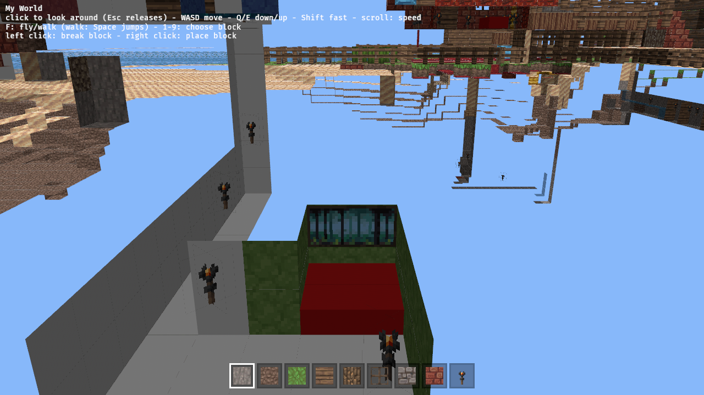
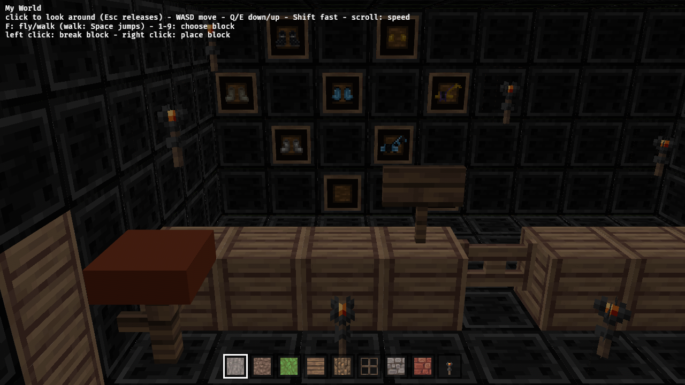

Draw painting and item-frame entities from the world's entity records (mcpe2java decodes them). Paintings: motif -> size + texture region from the painting atlas; item frames: frame quad plus the item's icon. Static only. Verify: count of entities drawn on the bundled world, screenshot of at least one painting.

---
▸ 2026-11-01T03:40:06Z [herd]
kind: claim
---

Claim (herd) for worker `paint-1`.

Scope:

- Draw painting and item-frame entities from the sample world. `mcpe_world` chunks expose `entities` and `block_entities` (Bedrock NBT); `crates/mcpe2java/src/entities.rs` shows how paintings (entity id 83) and item frames (a block entity in PE 0.x, tile 199) are decoded — the viewer cannot depend on mcpe2java (no Cargo.toml edits), so reimplement the small bits needed or move shared helpers only if trivial; record a `Decision:`.
- Paintings: motif -> size and texture. Textures live in `crates/memcraft-viewer/assets/textures` (see `textures-sources.txt` and ATTRIBUTION for the licence). If no suitably licensed painting art is available, draw sized framed quads with a flat colour per motif and record the `Decision:`.
- Item frames: the frame quad plus the held item's icon if one is easy to get from the atlas; otherwise just the frame.
- Static only; no interaction. Entities do not collide.

Judge: herd re-runs the evidence on main.

Evidence:

- A log line or test with the count of paintings and item frames drawn on the bundled world.
- `cargo test --workspace`, clippy native and wasm, `sh crates/memcraft-viewer/web/build.sh`.
- Headless screenshot showing at least one painting (find its position from the entity data and point the camera there; drive.js accepts KEYS, or add a URL/debug spawn option only if it already exists).

---
▸ 2026-11-01T03:40:06Z [herd]
kind: move
from: hairy
to: shaving
---

moved: hairy -> shaving

---
▸ 2026-11-01T15:21:48Z [herd]

Runner was wiped again (~11h ago, found Sun Nov  1 15:21:48 UTC 2026); workers door-1/paint-1/sign-1 show no progress since 03:40Z and their runner checkouts are gone. Treating as dead pending Joel's go-ahead to respawn.

---
▸ 2026-11-01T15:33:28Z [delta:paint-2]

Worker paint-2 start: Sun Nov  1 15:33:28 UTC 2026. yaks path: /home/user/.local/share/yaks/farms/memcraft/.yaks/mem/yaks/mem-15e6.md. Base main 48ed523.

---
▸ 2026-11-01T15:44:07Z [delta:paint-2]

Progress ($(date -u) approx): bundled world has 157 paintings (44 with plain id 83 plus 113 whose id has flag bits above the low byte, 4194387) and 9 item frames (block entity ItemFrame + block 199), holding armour boots and horse armour. Painting Pos is the slab centre, Direction 0..3 = +z,-x,-z,+x facing. Wrote src/entities.rs (decode, meshes, spawn system), build.rs embeds assets/paintings atlas, 28 PP textures added to assets/textures. Now compiling/testing.

---
▸ 2026-11-01T16:18:26Z [delta:paint-2]

Progress: entities.rs done; `cargo test --workspace` all ok (incl. 2 new entities tests: 157 paintings + 9 item frames decoded on the bundled world, every painting's wall cells are non-air and its front cells are not opaque cubes, every frame has a block behind it, winding/orientation test); clippy native -D warnings clean; clippy wasm -D warnings clean. web/build.sh running; then headless screenshot.

---
▸ 2026-11-01T22:09:39Z [herd-memcraft]

paint-2's worktree is unrecoverable (runner wiped; merge_worktrees: version does not reach its origin). Respawning as paint-3 from main 0a53ca6. paint-2 had reached: entities.rs, assets/paintings/, item textures, 157 paintings + 9 item frames drawn.

---
▸ 2026-11-01T22:10:40Z [paint-3]

paint-3 start: Sun Nov  1 22:10:40 UTC 2026. Checkout /home/user/memcraft-2, base main 0a53ca6. Rebuilding paint-2's work (lost).

---
▸ 2026-11-01T22:30:29Z [paint-3]

Progress: rebuilt entities.rs, item_icons.rs, build.rs painting embed, PP painting+item textures (+sources/attribution/README). cargo test --workspace passes (157 paintings, 9 frames, 8 with icon). Checkpoint commit local. Now clippy + web build + Playwright.

---
▸ 2026-11-01T23:32:22Z [paint-3]

Done, committed locally as 7bb9ab7 (one commit on main over 0a53ca6; not pushed, not shorn).

**What changed**
- `entities.rs`: paintings from the entity records (id&0xff==83, `Pos`, `Direction`, `Motive`) and item frames from `ItemFrame` block entities (block 199). Static meshes spawned once in PostStartup; logs `drew N paintings and M item frames (K with an item icon)`.
- `item_icons.rs` + 151 Pixel Perfection item textures (`item_*.png`): held item icon on frames (block items use their side tile, dyes tinted).
- `build.rs` embeds the painting sheet; paintings have their own image/material rather than going in the block atlas.
- `mcpe-world` re-exports `nbt::Tag` (no Cargo.toml edits); a few mesh/world helpers made `pub`.
- Assets listed in textures-sources.txt, ATTRIBUTION.md, README.

**Evidence**
- `cargo test --workspace` pass; `cargo clippy --workspace --all-targets -- -D warnings` clean; wasm clippy and `sh crates/memcraft-viewer/web/build.sh` ok (before final squash; native checks re-run after).
- Headless Chromium (`NODE_PATH=~/tools/drive/node_modules node crates/memcraft-viewer/web/drive.js <dist> <out>`): console `drew 157 paintings and 9 item frames (8 with an item icon)`.
- Screenshots attached were taken with a temporary build-time camera override (DBG_VIEW in start_view) so the camera sits in front of a painting / the frames room; that override is NOT in the commit.

**Known gaps**: static only (no interaction/targeting/break); paintings are a front quad only (no rim/back); item rotation, enchant glint, damage variants other than dye and items without a Pixel Perfection icon are not drawn; shading uses the same `light` heuristic as blocks.
