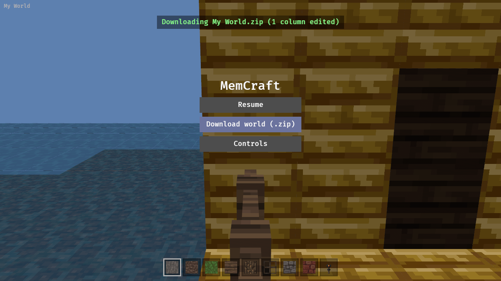
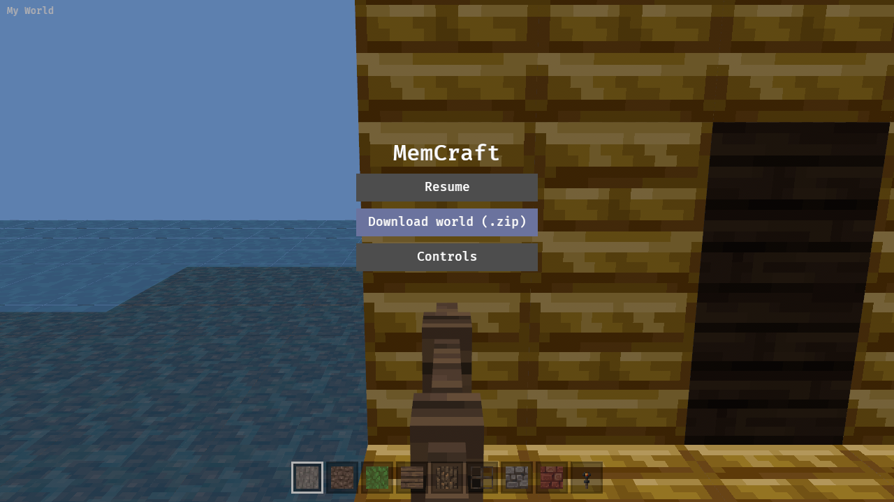

Wire the menu's Save to the world writer: native writes the world dir (the viewer must also be able to load a world from disk, not only the embedded one); the browser does whatever the open question on the parent yak decides (download a zip, browser storage, or a server).

---
▸ 2026-11-02T01:15:27Z [save-1]
kind: move
from: hairy
to: shaving
thread: ksQQOn_lPggNQrKkBKNvXOzaN5LOAD2xo5IBxBD-0Otq811F0oo4eGE3HRbr
---

moved: hairy -> shaving

---
▸ 2026-11-02T01:20:06Z [save-1]

save-1 checkpoint: code for zip download (download.rs), toast.rs feedback, SaveLabel, drive.js SAVE stage written; first compile pending (runner cold build running).

---
▸ 2026-11-02T01:43:13Z [save-1]

Decision: browser download uses the `zip` crate (v9, default-features=false, deflate-flate2 — the same minimal build mcpe2java already uses, so no new crate in the lock beyond its tree; pure Rust, wasm-friendly). Rejected: hand-rolled stored-only zip (more code to own, no compression for level.dat), flate2-only tar.gz (Windows/mac users expect .zip), JS-side JSZip (a JS dependency in a Rust-only web build). Zip layout: one folder <world name>/ with level.dat, levelname.txt (newly embedded by build.rs as EXTRA_FILES) and db/*. Downloads do not mark edits saved: each zip is the embedded world plus all edits since page load. A download with no edits is allowed (the plain world).

Native tests pass (cargo test --workspace: 106 viewer tests), clippy native+wasm clean. Web build + Playwright drive next. checkpoint commit 9e6f0f6

---
▸ 2026-11-02T02:09:40Z [save-1]
kind: summary
commit: e1a4180
---

Summary (save-1), final commit e1a4180 on top of a354d0d (several 'mem-5219: wip' commits precede it; squash as you like).

What changed:
- Browser: the menu's Save reads 'Download world (.zip)' (menu::SaveLabel, set by SavePlugin on wasm). It builds embedded world + edited columns via WorldWriter::from_files (src/main.rs embedded_writer), zips <world name>/{level.dat, levelname.txt, db/*} with the zip crate (src/download.rs), and downloads through a Blob + hidden anchor (web-sys). Edits are not marked saved, so every download holds all edits since page load; a download with no edits is the plain world. build.rs embeds levelname.txt as EXTRA_FILES.
- Shared: save::edited_world(writer, columns) is used by the native save_world and the browser download. Native behaviour unchanged (backup, in-place write); only its messages changed.
- Feedback: src/toast.rs, a top-centre line over the menu and the game, 4 s wall-clock, green/red, fed by a Toast message from save_on_request (native: saved N columns / nothing to save / failed / embedded world; browser: Downloading X.zip (N columns edited) / Download failed). Also logged.
- drive.js: SAVE=1 stage (with CAM): breaks the crosshair block, opens the menu, clicks the download button, saves world.zip, prints SAVE_EDIT=x,y,z, screenshots saved.png / saved-later.png.

Evidence:
- cargo test --workspace: all pass (106 viewer tests, 1 ignored = the drive checker). New tests: zip re-opens via World::from_files with the edit and all other columns equal; each download keeps all edits; safe file names; toast timing/replacement; save toasts for nothing/failed/saved/embedded.
- cargo clippy --workspace --all-targets and cargo clippy -p memcraft-viewer --target wasm32-unknown-unknown: no warnings. sh crates/memcraft-viewer/web/build.sh: builds.
- Drive: NODE_PATH=~/tools/drive/node_modules CAM=119.5,66.0,12.5,180,12 SAVE=1 WAIT=20000 node crates/memcraft-viewer/web/drive.js crates/memcraft-viewer/web/dist OUT -> 'broke (69, 3) at [119, 65, 9]', downloaded 'My World.zip' (1.0 MB), 1 edit logged. unzip -> DRIVE_WORLD='OUT/unzipped/My World' DRIVE_EDIT=119,65,9 cargo test -p memcraft-viewer -- --ignored drives_download: block is (69,3) embedded, (0,0) in the download; exactly 1 column differs. mcpe2java on the unzipped folder converts fine.
- Screenshots attached: saved.png (toast over menu with the download button), saved-later.png (toast gone).

Gaps: native toast verified by unit tests only (no display here). Zip entries carry a 1980 mtime (no clock without the zip 'time' feature). Only level.dat/levelname.txt/db are embedded; level.dat_old and players/ from the sample dir are not in the zip. Ctrl+S in the browser downloads too (relies on prevent_default_event_handling; not driven). Toast text can be long for native paths (wraps at 90% width).

---
▸ 2026-11-02T02:22:43Z [herd-memcraft]

Landed c8d53fa on main (save-1's e1a4180 squashed via git, not merge_worktrees). Herd re-ran on main: 106 viewer tests, clippy native+wasm clean, web/build.sh OK; drive CAM=119.5,66.0,12.5,180,12 SAVE=1 broke (69,3) at [119,65,9] and downloaded My World.zip (1.0 MB); unzipped and 'DRIVE_WORLD=... DRIVE_EDIT=119,65,9 cargo test -- --ignored drives_download' passed. Gaps per save-1: native toast unit-tested only, zip mtime 1980, level.dat_old/players not in zip, Ctrl+S download not driven.

---
▸ 2026-11-02T02:22:43Z [herd-memcraft]
kind: move
from: shaving
to: shorn
thread: ksQQOn_lPggNQrKkBKNvXOzaN5LOADYRe5IBxBCA0aLJyrhJPreUvVwLftHG
---

moved: shaving -> shorn
