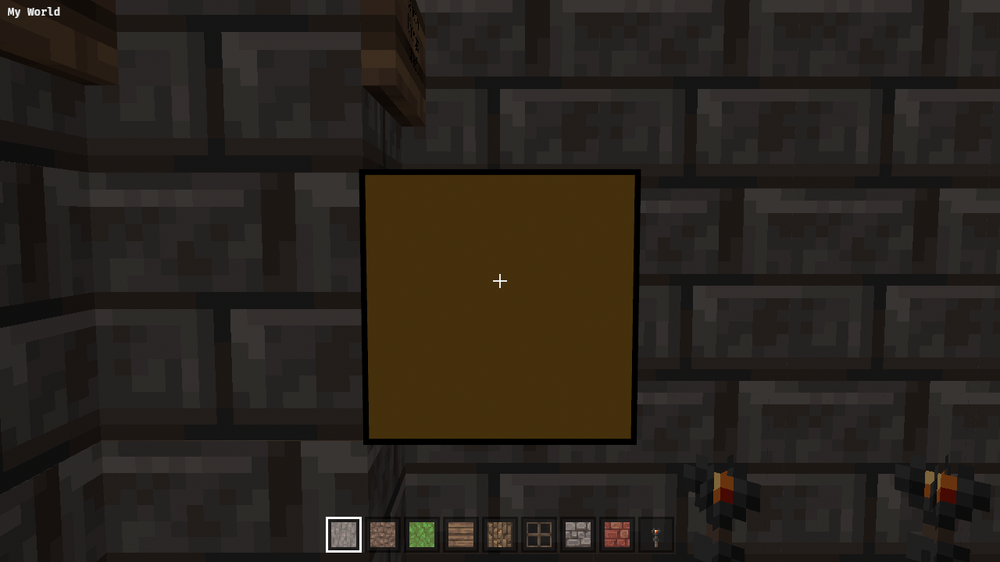
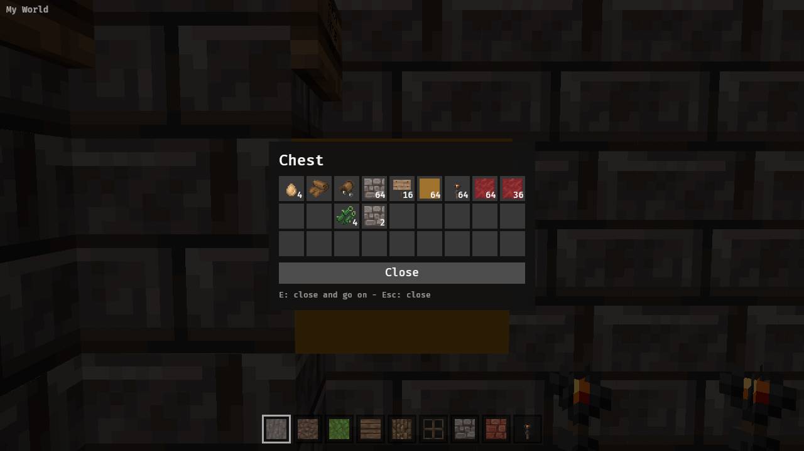
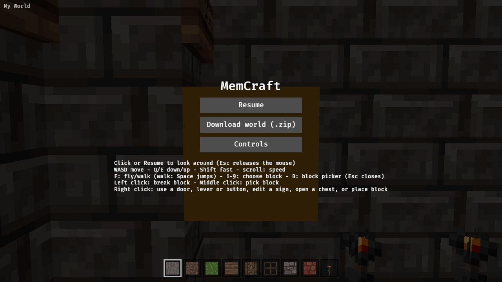

Chests (including double chests), furnaces, dispensers, droppers, hoppers, brewing stands: right click opens a view of the block entity's `Items`.

Scope depends on the open question on the parent yak: view-only, or moving items between the container and the hotbar (which today holds blocks only, so items need icons and names first).

---
▸ 2026-11-01T03:39:06Z [herd]

Scope per Joel (mem-f4c5 answer 2): view-only first — open a chest/furnace/etc. UI showing its slots from the block entity. Item moves split out to mem-834e.

---
▸ 2026-11-02T02:53:40Z [chest-1]
kind: move
from: hairy
to: shaving
thread: ksQQOn_lPggNQrKkBKNvXOzaN5LOAD4BcZIBxBD-0Otq811F0oo4eGE3HRbr
---

moved: hairy -> shaving

---
▸ 2026-11-02T02:53:40Z [chest-1]

Started on chest-1, base 0c5f2b8. Plan: ContainerView message from targeting, container_view.rs (panel), CHEST drive stage.

---
▸ 2026-11-02T03:09:20Z [chest-1]
kind: checkpoint
commit: 5f8c67c96d45799f35a4fb2b59f85220781c5cd8
---

Checkpoint: containers.rs (slot reading, double-chest pairing, tests), container_view.rs (panel, Esc/E/Close), targeting hook, drive CHEST stage drafted. Unit tests pass (cargo test -p memcraft-viewer). Sample world has no double chest; chest at 93,77,110 has 11 stacks. Next: clippy native+wasm, web build, drive screenshot.

---
▸ 2026-11-02T04:25:16Z [chest-1]

Commits 5f8c67c + 3346d5b (local, not pushed). Right-click a chest/trapped chest/barrel/hopper/dropper/dispenser/furnace family/brewing stand/shulker box opens a read-only inventory window (containers.rs: layouts + double-chest pairing via pairx/pairz with adjacency fallback, top half = lower x/z; container_view.rs: panel/OpenContainer; targeting hook; menu help; README; drive.js CHEST stage + camera unit test). E or Esc or Close button closes; Esc leaves the pointer free, E/Close relock. Evidence: cargo test --workspace ok, clippy (native + wasm32) clean, browser drive CHEST=1 CAM=90.5,77.8,110.5,270,5: window shows 9x3 with 11 stacks, 0 block edits by stage; screenshots chest-before/open/esc attached. Gaps: no item names/tooltips (unknown ids show number); double-chest top/bottom order unverified vs PE, no double chest in sample world (synthetic tests only); right-click doesn't close; entities.rs held_icon duplicates icon mapping (follow-up); move items = mem-834e; furnace/brewing progress not shown; drive stage timing-sensitive under SwiftShader.

---
▸ 2026-11-02T04:34:30Z [herd-memcraft]

Landed af1c65a on main (chest-1's 3346d5b squash-merged; targeting.rs tests and drive.js ORIENT/CHEST stages resolved by keeping both). Herd re-ran on main: 157 viewer tests, clippy native+wasm clean, web/build.sh OK; drive CAM=90.5,77.8,110.5,270,5 CHEST=1 shows the 9x3 chest with 11 stacks (screenshot checked), stage edits 0, E relocks, Esc leaves pointer free. Gaps: no item names/tooltips, double chest only synthetic-tested, held_icon duplication in entities.rs.

---
▸ 2026-11-02T04:34:30Z [herd-memcraft]
kind: move
from: shaving
to: shorn
thread: ksQQOn_lPggNQrKkBKNvXOzaN5LOADYRe5IBxBCA0aLJyrhJPreUvVwLftHG
---

moved: shaving -> shorn
