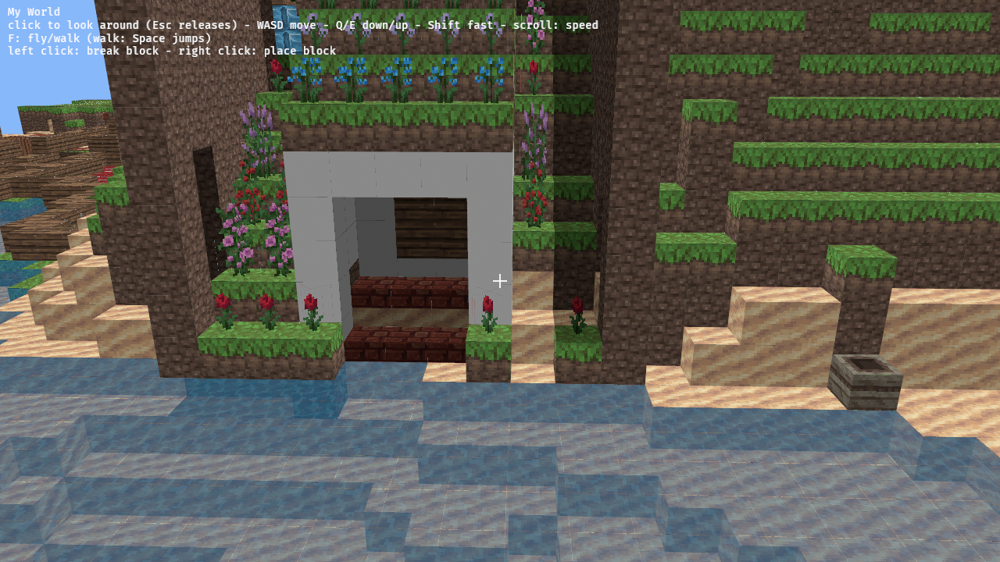
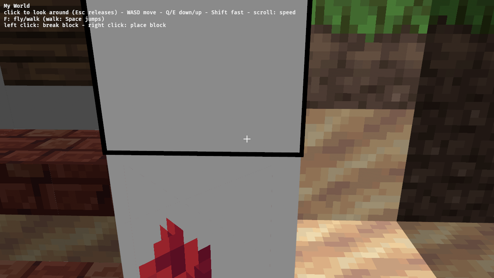
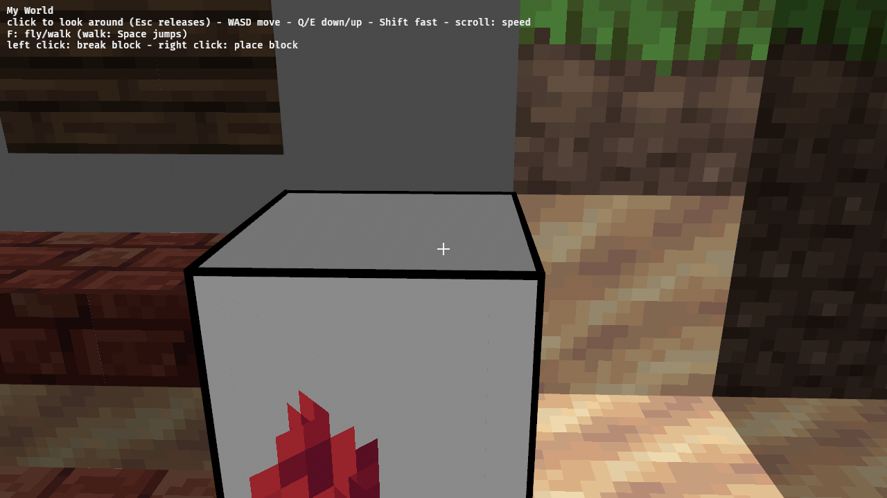
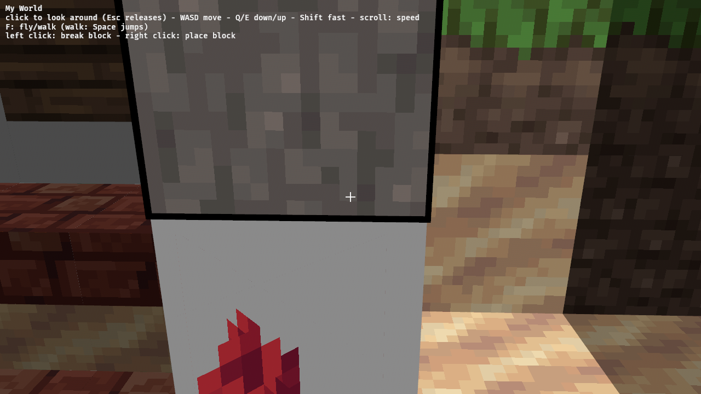
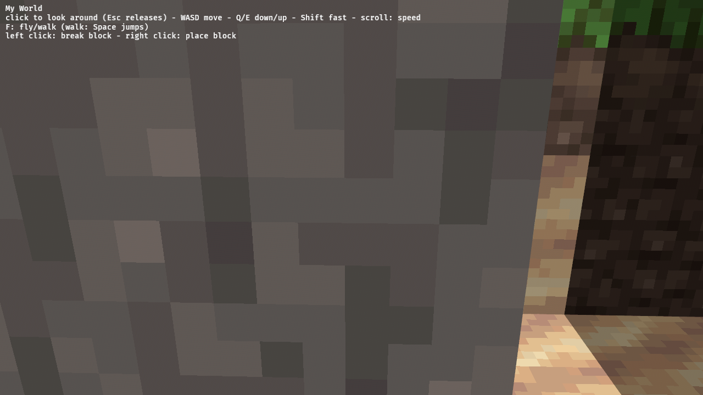

The core creative loop, while the pointer is locked.

## Scope

- Crosshair at screen centre.
- Voxel ray cast (DDA) from the camera, reach about 6 blocks in walk mode (more in fly mode?); a thin outline box on the targeted block.
- Left click breaks the targeted block (instantly, no drops). The click that locks the pointer must not also break.
- Right click places the hotbar's selected block against the targeted face; refuse if it would overlap the player's body.
- Uses the editable world (`set_block`) and the shared `Hotbar` type; until the hotbar UI lands, the selected slot defaults to a stone block.

## Out of scope

Orientation of directional blocks (logs, stairs, doors: a later yak), the hotbar UI, the picker.

## Evidence

- Unit tests for the ray cast (axis-aligned, diagonal, through chunk seams, max reach) and the "not inside the player" rule.
- drive.js run: lock, break a block, place one, screenshots before/after.

---
▸ 2026-11-01T01:59:30Z [herd]
kind: move
from: hairy
to: shaving
---

moved: hairy -> shaving

---
▸ 2026-11-01T01:59:30Z [herd]

Claim: worker `tgt-1` (Delta subthread), base `8fc3164`.

- Scope: new `crates/memcraft-viewer/src/targeting.rs` (ray cast, crosshair, outline, break/place systems), registration in `main.rs`, and the click handling in `controls.rs` `grab_pointer` (so the locking click doesn't also break). Remove the `allow(dead_code)` markers on the `world.rs`/`physics.rs`/`hotbar.rs` editing API as it becomes used.
- Mouse buttons: yakherd's lean pending Joel's answer on `mem-4fcd` (left break, right place, middle reserved for pick-block). Keep the binding in one place so it is easy to change.
- Out of scope: hotbar UI (`hot-1`), block shapes (`shape-1`; outline the full block for now), orientation.
- Evidence: ray-cast unit tests and the not-inside-the-player test; drive.js break/place screenshots.
- Judge: yakherd at landing.

---
▸ 2026-11-01T02:00:44Z [tgt-1]

Started: Sun Nov  1 02:00:44 UTC 2026

yaks path: /home/user/.local/share/yaks/farms/memcraft/.yaks/mem/yaks/mem-6934.md

---
▸ 2026-11-01T02:25:29Z [tgt-1]

Milestone: `targeting.rs` written, unit tests pass (35 in the crate, 11 new in targeting), native clippy `-D warnings` clean, wasm clippy clean. Web build + drive scenario next.

Decision: outline is a `LineList` mesh entity (unlit black, 1.004x the block), not gizmos. `bevy_gizmos` is not in the crate's Bevy feature list and Cargo.toml is off limits. Rejected: gizmos (needs feature), 12 thin cuboids (heavier, thicker than "thin").

Decision: clicks are handled in `edit_blocks`, ordered `.before(grab_pointer)`, acting on the `Target` computed at the end of the previous frame (what was drawn when the user clicked). So the locking click sees the pointer unlocked and only locks. Rejected: a "just locked" flag in controls (extra state).

Decision: button bindings (`LOCK_BUTTON`, `BREAK_BUTTON`, `PLACE_BUTTON`) are consts at the top of `controls.rs`; middle stays unbound (reserved for pick).

Decision: a ray starting inside a block skips that block (so there is always a face to report); reach is measured to the entry point of the hit block.

Decision: placing is refused only if the block would be solid (not Air/Cross shape) and overlaps the player box (walk: 0.6x1.8 body, fly: 0.2 cube at the camera), with a 1e-3 shrink like physics so resting on a block is not "inside" it. Plants/torches may go anywhere. Rejected: refusing every block (annoying for torches, flowers).

Decision: replaceable cells = air, liquids (8-11), tall grass 31, fire 51, snow layer 78, vine 106. Everything else must be built against.

Decision: `WorldMap::world()` keeps an `allow(dead_code)` (reason updated: only tests use it); all other editing-API markers removed.

[drive-summary](mem-6934/drive-summary.txt)

---
▸ 2026-11-01T03:19:45Z [tgt-1]

Decision: outline is 12 thin black cuboid bars (child entities), not a LineList mesh: LineList rendered nothing in the browser (SwiftShader/WebGL). No bevy_gizmos feature enabled.

---
▸ 2026-11-01T03:19:45Z [tgt-1]

Evidence Sun Nov  1 03:19:45 UTC 2026: cargo test -p memcraft-viewer -> 'test result: ok. 35 passed; 0 failed'. cargo clippy -p memcraft-viewer --all-targets -- -D warnings (native) -> Finished, clean. Same with RUSTFLAGS='--cfg getrandom_backend="wasm_js"' --target wasm32-unknown-unknown -> Finished, clean. sh crates/memcraft-viewer/web/build.sh -> exit 0. Playwright drive (KEYS=w 1500ms, PITCH=0): locking click made no edit; left click logged 'broke (247, 0) at [44, 66, 225]'; right click 'placed (1, 0) at [44, 66, 225]', again '... [44, 66, 226]'; Esc then re-lock click made 0 edits. Screenshots attached.

---
▸ 2026-11-01T03:19:50Z [tgt-1]

Summary: new targeting.rs (DDA cast, outline, crosshair, break/place with can_place rule), click buttons as consts in controls.rs, help text/README updated, dead_code markers removed for the block-edit API. Not covered: breaking/placing is whole-cube (shapes ignored), no break animation/sound.

---
▸ 2026-11-01T03:19:50Z [tgt-1]
kind: move
from: shaving
to: shorn
---

moved: shaving -> shorn

---
▸ 2026-11-01T03:19:53Z [tgt-1]
kind: checkpoint
branch: wip/tgt-1
commit: 546dabf353da6ac74d2190b82ff4050005a9d2b9
---

checkpoint
