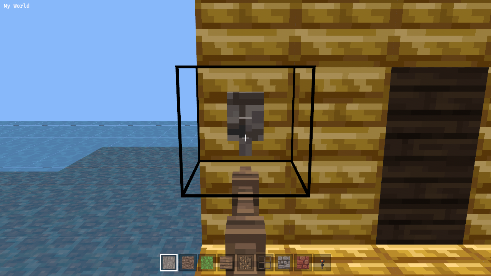
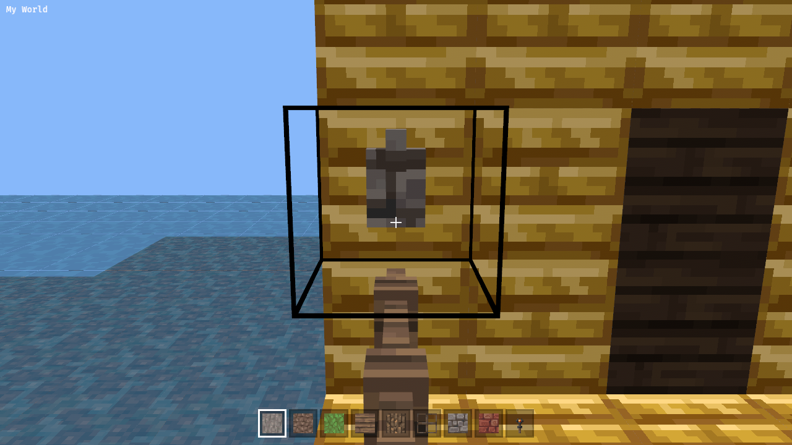

Right-clicking a lever flips its data bit (on/off); a button sets its pressed bit and pops back after ~1s (stone 20 ticks, wood 30). No redstone propagation (out of scope, see simulation yak). Needs lever/button shapes in blocks::shape if they still draw as cubes. Interaction takes precedence over placing when the target is interactable (same rule as mem-1457). Verify: unit test for the data-bit flip; headless drive showing the lever changes on click.

---
▸ 2026-11-01T23:40:27Z [lever-1]
kind: move
from: hairy
to: shaving
thread: ksQQOn_lPggNQrKkBKNvXOzaN5LOAD1VZJIBxBD-0Otq811F0oo4eGE3HRbr
---

moved: hairy -> shaving

---
▸ 2026-11-01T23:57:28Z [lever-1]

Checkpoint b9d91c7 (local, not pushed).

- Lever (69) and button (77 stone, 143 wood) shapes already exist in blocks::model, so no shape work.
- interact.rs: lever flips bit 8; button sets bit 8 and swallows clicks while down.
- New buttons.rs: PendingReleases (tick bookkeeping driven by elapsed seconds, 20 ticks/s) + release_buttons system; targeting::edit_blocks schedules a release on a press.
- Unit tests pass (cargo test -p memcraft-viewer: 80).

Heads-up for the herd: HEAD a48f18b has the same tree as 1569374 (menu), so the paintings/item-frame changes of 7bb9ab7 are only uncommitted in my worktree. I committed only my own files/hunks.

Next: clippy native+wasm, web build, Playwright drive.

---
▸ 2026-11-02T00:41:12Z [lever-1]

Summary (lever-1), commit 33eb977 on local main (base a48f18b; not pushed).

What changed:

- interact.rs: a lever (69) flips bit 8; a button (77 stone, 143 wood) sets bit 8 and swallows further clicks while down (no placing, no extended press).
- buttons.rs: PendingReleases (tick counter driven by elapsed seconds, 20 ticks/s; stone 20, wood 30) + release_buttons system, which clears the bit only if the block is still a pressed button. targeting::edit_blocks schedules a release on a press.
- Lever/button shapes already existed in blocks::model (mem-12d5), so no shape work.
- debug_view.rs: ?cam=x,y,z,yaw,pitch (browser) / MEMCRAFT_CAM (native) start view, so the drive can aim; drive.js LEVER=1 stage. Also fixed drive.js: the lock click moved the mouse 440 px, which turned the view 28 degrees; it now moves first and waits.
- Menu help, README, main.rs doc updated.

Evidence (commands re-runnable as-is):

- cargo test --workspace: all pass (viewer 82, incl. lever flip, button press/ignore, button release timing, cam parsing).
- cargo clippy --workspace --all-targets: clean; cargo clippy -p memcraft-viewer --target wasm32-unknown-unknown: clean.
- sh crates/memcraft-viewer/web/build.sh: builds.
- NODE_PATH=~/tools/drive/node_modules CAM=119.5,66.0,12.5,180,12 LEVER=1 WAIT=20000 node crates/memcraft-viewer/web/drive.js crates/memcraft-viewer/web/dist OUT: log 'toggled (69, 3) at [119, 65, 9]: now (69, 11)', 1 edit. Screenshots attached: handle down before, up after.
- Plain drive (no CAM): 0 edits, lock/menu checks as before.

Known gaps: the button's timed release is unit-tested but not seen in the browser; no button in the drive. Lever sample-world data is mostly 'on' (bit 8 set), unrelated.

Herd: HEAD a48f18b has the tree of 1569374, so the paintings/item-frame changes of 7bb9ab7 are missing from the commit and only uncommitted in my worktree; I committed only my own files/hunks (README and main.rs partially). Check the merge.

---
▸ 2026-11-02T01:14:24Z [herd-memcraft]

Landed a354d0d on main (with mem-c910). Delta's worktree merge dropped lever-1's interact.rs change; herd re-applied it from 33eb977. Herd evidence on main: 100 viewer tests, clippy native+wasm clean, web build OK, drive CAM=119.5,66.0,12.5,180,12 LEVER=1 logs 'toggled (69, 3) at [119, 65, 9] ... now (69, 11)' and the screenshot shows the lever flipped. Gap: button pop-back seen in unit tests only.

---
▸ 2026-11-02T01:14:25Z [herd-memcraft]
kind: move
from: shaving
to: shorn
thread: ksQQOn_lPggNQrKkBKNvXOzaN5LOADYRe5IBxBCA0aLJyrhJPreUvVwLftHG
---

moved: shaving -> shorn
