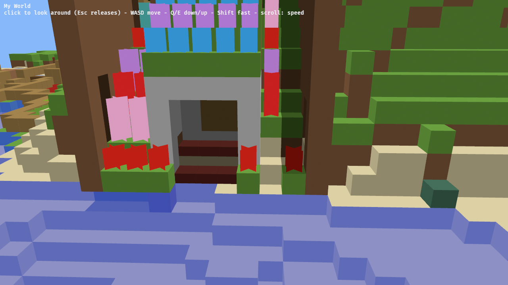
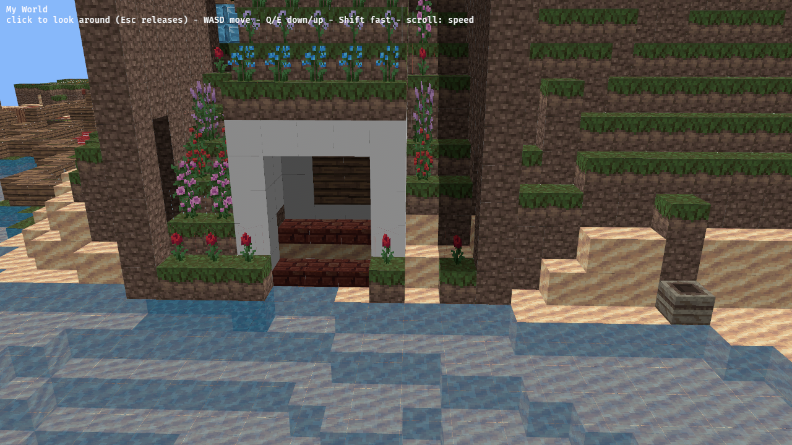
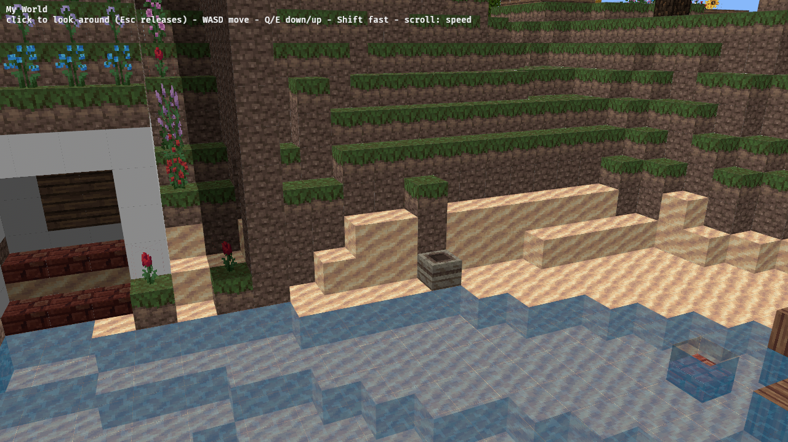

And make sure they get rendered. Let's find something as close as we can to the originals, while still being freely distributable.

---
▸ 2026-10-29T17:19:38Z [delta:Set up remote yak workflow]

moved: hairy -> shaving

---
▸ 2026-10-29T17:19:38Z [delta:Set up remote yak workflow]

Claim (yakherd: this thread). Owner: worker `tex-1`.

- Scope: texture atlas + UVs in `crates/memcraft-viewer/src/mesh.rs`, `blocks.rs` (per-face texture choice), material setup in `main.rs`, asset files under `crates/memcraft-viewer/assets/` with a LICENSE/attribution file, embedded at build time like the world.
- Out of scope: `controls.rs` and camera/movement (owned by `mem-f13a`).
- Evidence: license text of the chosen pack recorded; headless browser screenshots before/after from the same viewpoint; tests still pass; wasm size before/after.
- The pack choice is a design fork: worker records candidates and asks, but prototypes with its lean meanwhile.

---
▸ 2026-10-29T17:21:52Z [tex-1]

Start: 2026-10-29T17:21:48Z (date -u). Worker tex-1. yaks path: /home/user/.local/share/yaks/farms/memcraft/.yaks/mem/yaks/mem-7aba.md

---
▸ 2026-10-29T17:25:46Z [tex-1]

Decision: texture pack = Pixel Perfection (XSSheep, CC BY-SA 4.0), taken from the community-maintained MC-format fork "Pixel Perfection CE" (github.com/Athemis/PixelPerfectionCE @ 28e38cab, LICENSE.md = full CC BY-SA 4.0 legal code; README: "Originally envisioned and created by XSSheep"). Rejected / alternatives surveyed (license text read):

- Pixel Perfection 3.6 original (XSSheep, planetminecraft.com/texture-pack/131pixel-perfection): "licensed under a Creative Commons Attribution-Share Alike 4.0 International License", feel free to reuse in mixpacks, credit appreciated. Cleanest provenance but only downloadable via the PM page (JS gate); not scripted from here. Same art as the CE fork for the 1.11-era blocks PE has.

- minetest-texture-packs/Pixel-Perfection (Minetest port of the same pack): CC BY-SA 4.0 ("Licensing: Creative Commons Attribution-Share Alike 4.0 International License"). Clean, but only Minetest nodes (~250 files): no granite/andesite/diorite, stained clay, quartz, redstone, nether blocks, etc. Used only as a cross-check of the CE files.

- VoxeLibre/MineClone2 (git.minetest.land/VoxeLibre/VoxeLibre LEGAL.md): "No non-free licenses are used anywhere"; textures "based on the Pixel Perfection resource pack for Minecraft 1.11 ... Most textures are verbatim copies"; per-file mix of CC BY-SA 4.0 and 3.0 (default), code GPLv3. Wide coverage but Minetest file names and per-mod licence juggling; same art as PP anyway.

- Minetest Game textures: CC BY-SA 3.0 (LICENSE.txt). Not Minecraft-looking.

- Kenney Voxel Pack: CC0 (kenney.nl), but 128px isometric tiles in its own style; not close to the original look.

- Faithful, Programmer Art, anything Mojang-derived: excluded by the brief.

Why CE as the file source: vanilla file names (grass_block_top, oak_log, ...), 991 files, covers every PE block id in blocks.rs incl. granite/diorite/andesite, terracotta, stained glass, quartz, nether. Risk: CE's own content_with_issues.md admits some verbatim Mojang textures "sneaked in" while updating to 1.13+ (currently lists only entity/banner/globe.png, which I do not use). Mitigation: I only use textures that exist in XSSheep's 1.11 set (all PE blocks are <=1.11) and will cross-check each used file against the Minetest port / VoxeLibre by hash where an equivalent exists and report the matches.

Licence note for the human: the texture atlas is an adaptation of CC BY-SA 4.0 art, so the atlas/assets stay CC BY-SA 4.0 with attribution (assets/LICENSE-textures + ATTRIBUTION); the Rust code stays MIT OR Apache-2.0. The wasm bundles both; I treat that as an aggregate (code is not a derivative of the art), but that is a legal judgement for you.

Lean: Pixel Perfection via CE fork. Prototyping with it now; the code only depends on a name->tile list, so swapping packs is replacing PNGs in assets/textures/.

---
▸ 2026-10-29T17:25:46Z [tex-1]

asked: needs human

Please confirm the texture pack. Lean: Pixel Perfection by XSSheep (CC BY-SA 4.0), files taken from the Pixel Perfection CE fork (see the Decision note for candidates and licences).

Questions: (1) OK to use Pixel Perfection? Alternatives that are free: VoxeLibre (same art, messier licensing), Kenney CC0 (not Minecraft-like).

(2) OK with CC BY-SA 4.0 assets (attribution + share-alike for the textures/atlas only, code unchanged) in the public GitHub Pages build?

(3) The CE fork vs. the original 3.6 zip: CE's own issues list shows some contamination risk in 1.13+ textures; I only use 1.11-era files and cross-check by hash. Fine, or do you want the original 3.6 zip dropped into assets/ instead?

I am proceeding with the lean in the meantime.

---
▸ 2026-10-29T17:38:23Z [tex-1]

Incident: for the first ~40 min I ran `cd ~/memcraft` and edited/staged files in /home/user/memcraft (the yakherd's checkout) instead of my own clone /home/user/memcraft-3. Yakherd noticed; I moved the work via `git diff --cached --binary > ~/logs/tex-1.patch` + `git apply --index` in /home/user/memcraft-3 (296 files staged there, matches). Side effects left in /home/user/memcraft: staged changes (Cargo.lock, viewer Cargo.toml/build.rs/src/assets), a ref refs/wip/tex-1 (from `git stash create`), build artefacts under target/ and crates/memcraft-viewer/web/dist (gitignored), a killed in-flight wasm build. I did not reset or clean anything there. From now on I only use /home/user/memcraft-3.

---
▸ 2026-10-29T17:56:36Z [Joel Webber]

That's all fine with me. Let's just get something going for now, and we can clean up later if needed.

---
▸ 2026-10-29T18:19:17Z [delta:Set up remote yak workflow]

picked up

---
▸ 2026-10-29T18:19:17Z [delta:Set up remote yak workflow]

Before: flat vertex colours (main 311a5a2)

---
▸ 2026-10-29T18:19:17Z [delta:Set up remote yak workflow]

After: textured atlas, headless Chromium (SwiftShader)

---
▸ 2026-10-29T18:19:17Z [delta:Set up remote yak workflow]

Landed (work by tex-1, finished/verified by yakherd). Pack: Pixel Perfection by XSSheep, CC BY-SA 4.0 (Joel approved); license + ATTRIBUTION in crates/memcraft-viewer/assets. build.rs bakes a 16px atlas (biome tints baked in); per-face tiles; opaque/cutout(mask 0.5)/blend passes; leaves don't cull neighbours. Evidence: cargo test --workspace pass; clippy native + wasm32 clean; wasm 22.25->22.54 MB; drive.js on local dist: pointer lock states correct, 294,689->332,961 quads, screenshots attached.

---
▸ 2026-10-29T18:19:17Z [delta:Set up remote yak workflow]

moved: shaving -> shorn
