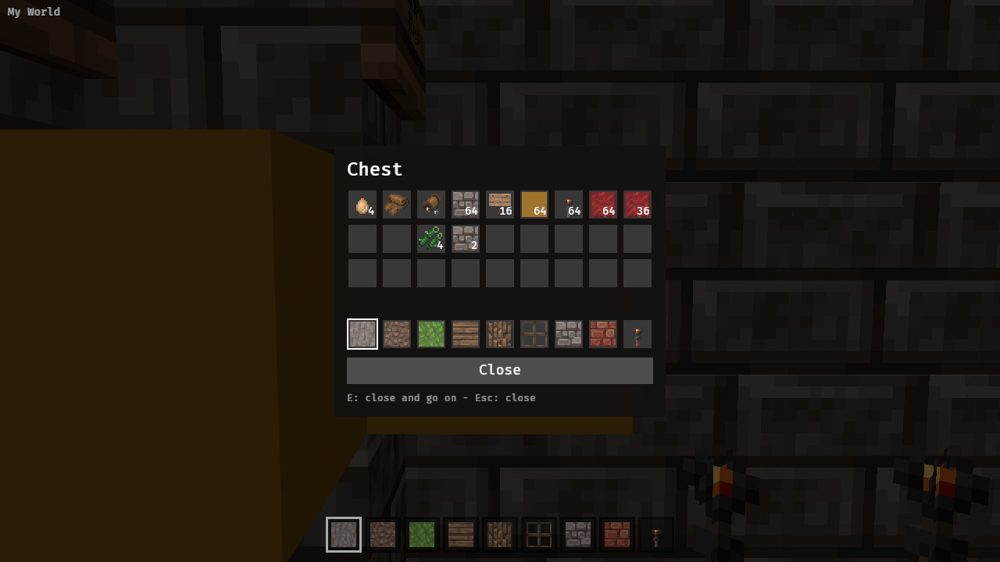
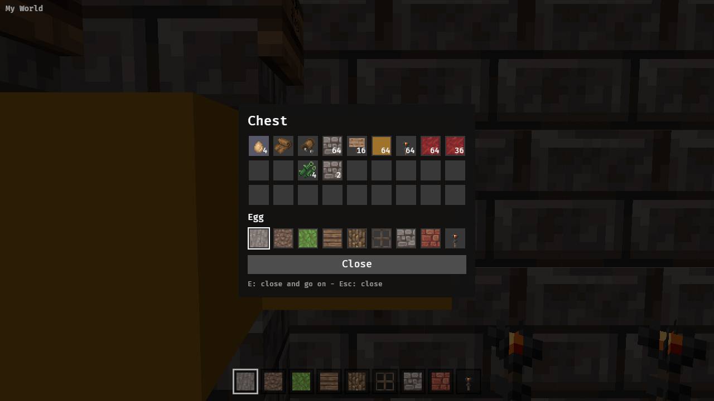

Follow-up to view-only containers (mem-5d8c). Moving items between a container and the hotbar means the hotbar holds items as well as blocks (icons and names for ~200 items) and edits are written to the block entity.

---
▸ 2026-11-02T08:32:33Z [items-1]
kind: move
from: hairy
to: shaving
thread: ksQQOn_lPggNQrKkBKNvXOzaN5LOAD7ILpIBxBD-0Otq811F0oo4eGE3HRbr
---

moved: hairy -> shaving

---
▸ 2026-11-02T08:48:31Z [items-1]

Checkpoint: items.rs (Stack, icon, name, exchange/send), hotbar of stacks, container window clicks + set_stack write-back, item names. Next: run tests, drive stage, clippy, wasm build.

