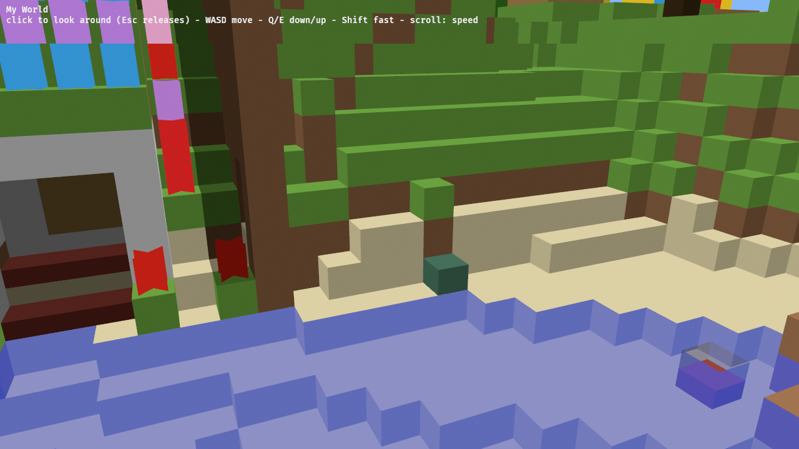

The UI displays "click to look around (Esc releases)", but you actually have to right-drag to look around.

---
▸ 2026-10-29T13:59:54Z [delta:Set up remote yak workflow]

moved: hairy -> shaving

---
▸ 2026-10-29T13:59:54Z [delta:Set up remote yak workflow]

Cause: Bevy 0.19's `FreeCamera` grabs the cursor only while `mouse_key_cursor_grab` (default `MouseButton::Right`) is held, or after the `M` toggle, and keeps that grab state in private `Local`s. Changing the button would still give hold-to-look, not click-to-look.

Fix: replace `FreeCamera` with a small controller the viewer owns (`crates/memcraft-viewer/src/controls.rs`). Left click locks the pointer and it stays locked; Esc, focus loss, or the browser dropping pointer lock releases it. Flight and scroll-for-speed work as before. Walk mode (`mem-f13a`) can then extend this controller.

Runner note: the cloud runner was reset mid-build (13:10–13:58 UTC) and lost the unsynced farm edits, so this claim is a re-do.




---
▸ 2026-10-29T17:19:12Z [delta:Set up remote yak workflow]

Fixed: left click now locks the mouse and it stays locked; Esc releases it, in the browser and natively.

## Shape of the fix

- Bevy's `FreeCamera` only looks while its grab button (right) is held, and its grab state is private, so it's replaced by [`controls.rs`](../crates/memcraft-viewer/src/controls.rs): click locks, Esc / focus loss / the browser dropping the lock releases. On wasm the browser handles Esc itself, so the controller re-reads `document.pointerLockElement` each frame. Flight (WASD/QE, Shift, scroll speed) is unchanged.
- The `free_camera` Bevy feature is dropped; `web-sys` is added for wasm only.

## Evidence

- `cargo test --workspace` passes, including the new `controls::tests::turning_keeps_the_start_facing_and_clamps_pitch`. Clippy is clean, native and `wasm32`.
- Headless Chromium ([`web/drive.js`](../crates/memcraft-viewer/web/drive.js)) against the `wasm-opt`'d build:

```text
locked before click: null
locked after left click: memcraft
locked after exitPointerLock (what Esc does): null
locked after clicking again: memcraft
```

- The mouse moving right with no button held turns the view right:


Not verified: the native build in a real window (no display on the runner).

Commits (local `main`, not pushed): `47076b0` fix, `433f8a0` smoke test, plus `3687d37` (runner setup script; `build.sh`'s `wasm-opt` step now passes the wasm feature flags, 26 MB → 22 MB).

---
▸ 2026-10-29T17:19:12Z [delta:Set up remote yak workflow]

moved: shaving -> shorn
