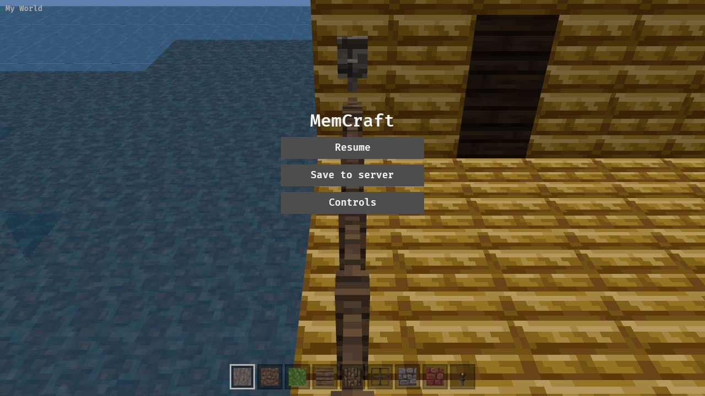
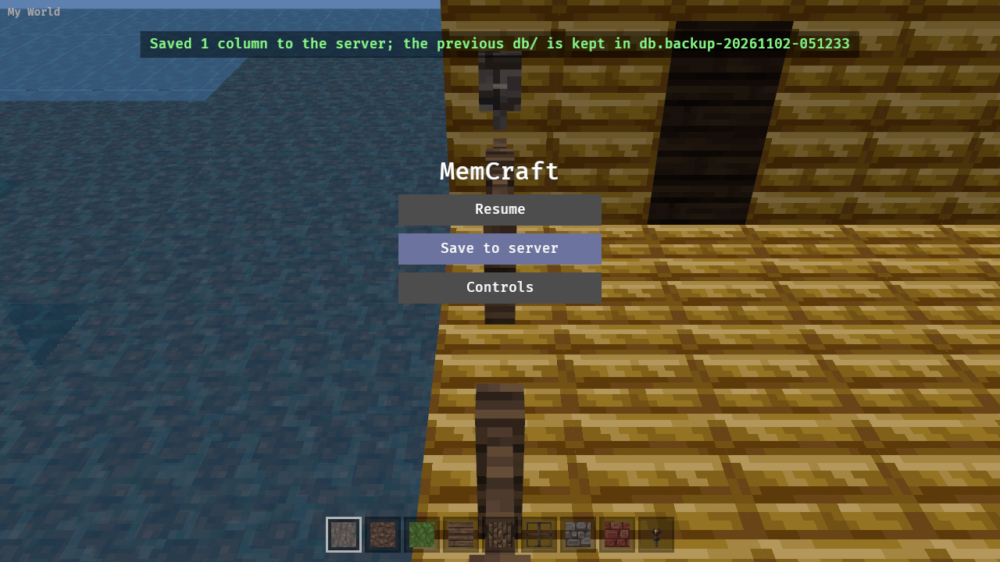
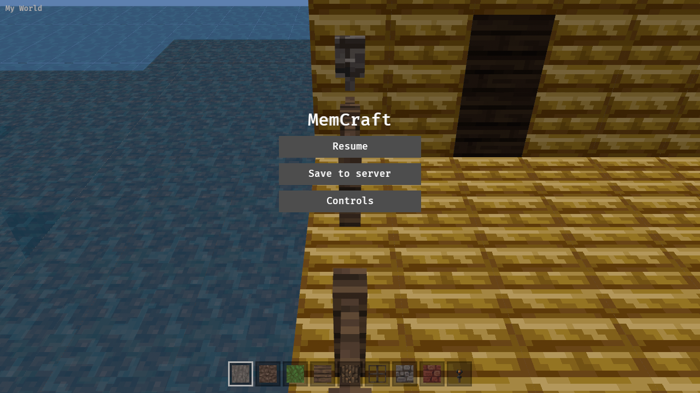

A small server that serves the web build and one world, and accepts saves from the viewer, so a hosted instance can persist edits. The Pages deployment stays read-only ("ephemeral").

Shape depends on the open question on the parent yak.

---
▸ 2026-11-02T04:35:37Z [server-1]
kind: move
from: hairy
to: shaving
thread: ksQQOn_lPggNQrKkBKNvXOzaN5LOAD5zeJIBxBD-0Otq811F0oo4eGE3HRbr
---

moved: hairy -> shaving

---
▸ 2026-11-02T04:37:48Z [server-1]

server-1 on mem-a1f7, base af1c65a.

Decision: new crate crates/memcraft-server (axum + tower-http ServeDir), one world dir, no auth. Endpoints: GET /api/world (JSON probe: name), GET /api/world/files (level.dat + db/* packed), PUT /api/world/columns (edited columns), static web dist as fallback.

Decision: save sends only edited columns, not the whole world. The server re-reads the dir and puts the columns over it (same as native save), so two viewers editing different columns don't clobber each other; a whole-world upload would be last-writer-wins on everything. Wire = the columns' own LevelDB records (what encode_column already makes), decoded by the existing decode path, so malformed input is rejected by the same code that reads worlds. Rejected: JSON/zip of blocks (new format to keep in sync).

Decision: shared save code (backup_db, utc_stamp, 'put columns over a dir with backup') moves from viewer save.rs into mcpe-world; native save and the server both call it. Packing helpers live in mcpe-world too (wire module).

Decision: the page probes and fetches the world in index.html JS before init() (async fetch inside a wasm-bindgen-futures task would be fatal: winit's control-flow exception thrown inside a task stalls the task queue); the viewer reads it from window and POSTs saves from Rust via web-sys fetch.

---
▸ 2026-11-02T04:40:15Z [server-1]
kind: checkpoint
commit: baf056f0ba36fcf4effbeb7367b8a9df4a578e11
---

checkpoint: mcpe-world has wire (pack/unpack world and columns) + save_columns (backup, moved from viewer); crates/memcraft-server done with 7 passing tests (probe, round trip with backup, bad body, stale viewers, static). Next: viewer wasm side, drive, README.

---
▸ 2026-11-02T05:01:13Z [server-1]
kind: checkpoint
commit: e2c0f5b8af475409b2a61ebcdbc7f0796a6f9bc0
---

checkpoint: viewer side (server.rs, index.html probe, drive HOSTED) done; cargo test --workspace and clippy native + wasm clean. Next: web/build.sh and the Playwright drive against the server.

---
▸ 2026-11-02T05:21:14Z [server-1]
kind: summary
commit: 653a997a85f211b2234c4752c02935668577d773
---

Summary: crates/memcraft-server (axum, tower-http ServeDir) serves web dist + one world dir. GET /api/world probe, GET /api/world/files (packed), PUT /api/world/columns (edited columns only, packed as their LevelDB records; server re-reads dir, puts columns over it, backup db.backup-<time>). Shared code moved into mcpe-world: save_columns/backup/utc_stamp (native save now calls it), WorldWriter::put_columns, wire pack/unpack of worlds and columns. Viewer: index.html probes before init() and stashes files in window.memcraftServer; server.rs (wasm) loads that world, label 'Save to server', one PUT in flight, edits marked saved on send and re-marked on failure. Pages unchanged (no server -> embedded world + zip).

Evidence: cargo test --workspace PASS (server: 7 tests, mcpe-world wire/save tests); cargo clippy --workspace --all-targets clean; RUSTFLAGS='--cfg getrandom_backend="wasm_js"' cargo clippy -p memcraft-viewer --target wasm32-unknown-unknown clean; sh crates/memcraft-viewer/web/build.sh OK. Drive: memcraft-server --world /tmp/srvworld(copy of sample) --addr 127.0.0.1:8080, then CAM=119.5,67.5,15,180,35 SAVE=1 HOSTED=1 NODE_PATH=~/tools/drive/node_modules node crates/memcraft-viewer/web/drive.js http://127.0.0.1:8080/ /tmp/shots: broke 119,64,11 (id 85), toast 'Saved 1 column to the server…', backup dir created, reloaded page shows the gap (attached hosted-*.png), and DRIVE_WORLD=/tmp/srvworld DRIVE_EDIT=119,64,11 cargo test -p memcraft-viewer -- --ignored drives_download PASS (World::open_dir shows block 0, only that column differs).

Gaps: no auth; last save of a column wins and viewers don't see each other's edits until reload; saved worlds' lighting not recomputed (as native); wasm viewer path (server.rs) only covered by the drive, not unit tests; the drive's HOSTED run saw one column only; debug server binary used (no release build).
