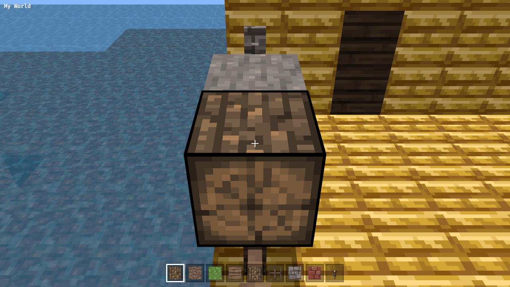
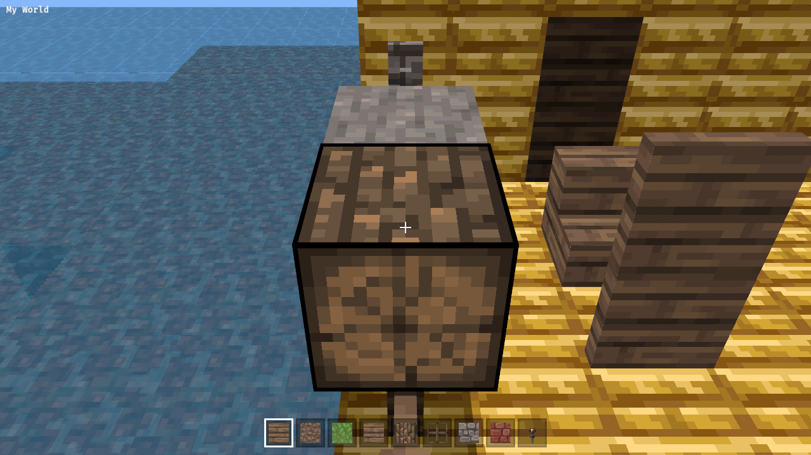
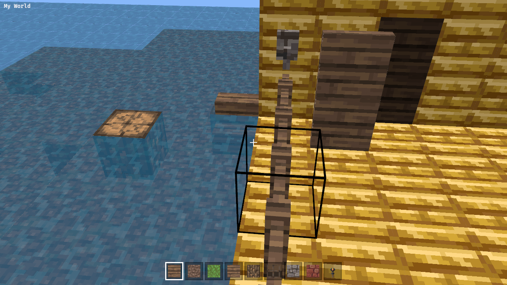

Placed blocks take their orientation from the face clicked and the player's facing, as in Minecraft: log axis, stairs facing and upside-down, top/bottom slabs, torches on walls, furnaces/chests/pumpkins facing the player, two-block doors and beds, ladders and signs on walls.

Data values follow PE 0.16 (see `mcpe2java/src/blocks.rs` for where PE differs from Java).

---
▸ 2026-11-02T02:53:46Z [orient-1]
kind: move
from: hairy
to: shaving
thread: ksQQOn_lPggNQrKkBKNvXOzaN5LOAD4CsJIBxBD-0Otq811F0oo4eGE3HRbr
---

moved: hairy -> shaving

---
▸ 2026-11-02T02:59:19Z [orient-1]

Checkpoint: new src/orient.rs (pure rule, per-family tests), targeting::placement/hit_height, top slabs drawn (blocks.rs), purpur slab 205 now a slab, Sign catalog entry. Tests still compiling. Not yet run: cargo test/clippy/web build, drive ORIENT stage.

---
▸ 2026-11-02T04:14:23Z [orient-1]

Done, commit 9335ef7 (on top of checkpoint 8d8eb21). Not pushed; herd lands.

What: right-click placement now orients the block (new `crates/memcraft-viewer/src/orient.rs`, pure fn `orient((id,data), normal, height, yaw) -> Vec<(offset, Block)>`; empty = can't place).
Families: logs (axis from clicked face), slabs (top half if clicked on underside or upper half of a side), stairs (facing from yaw, upside down like slabs), trapdoors, fence gates, furnace/dispenser/chests (front faces player), pumpkins, doors (2 cells, hinge left), beds (2 cells), double plants (2 cells), torches/ladders/signs (floor sign has 16 rotations; wall sign by face), buttons, levers. Everything else keeps its data.
Support: `targeting::hit_height` (ray vs face plane) and `targeting::placement` (every cell must pass can_place and be loaded); `edit_blocks` sets all cells. `blocks.rs` now draws top slabs (data bit 8) and fixes purpur slab 205 which was drawn as a full cube. `catalog.rs` gets a Sign (63,0) entry so signs are pickable/placeable. `Controller::yaw()`, `WorldMap::holds()` added. `web/drive.js` has an ORIENT stage (documented in header).

Evidence: cargo test -p memcraft-viewer 144 pass; cargo test --workspace, clippy --workspace --all-targets, clippy wasm32 clean (before drive.js-only edits; viewer tests rerun on final tree). Drive (SwiftShader, CAM=119.5,67.5,15,180,35): stone placed, log on its +z face got (17,8) (axis z), stairs (53,3), door (64,3)+(64,8), 5/5 edits logged. Screenshots attached: log axis z, stairs+door, run8 final. Drive is flaky: picker click sometimes misses (retry loop added) and the aimed spot varies, so run 8 put an upright log on top of a stone (correct for a top-face click) and counted 6 edits vs 5 because the base script broke a block first. cargo fmt --check flags build.rs, which this change doesn't touch.

Gaps / follow-ups: wall torches have right data but blocks.rs still draws them upright; no double-slab merging; pillars (hay/quartz/purpur), pistons, repeaters, rails, anvils not oriented; chests/beds drawn as flat boxes with no visible front; door hinge always left (no neighbour awareness); torches/ladders/signs/doors don't check support block; placing a sign does not open the editor (right-click an existing sign does); middle-click on a wall sign (68) still picks nothing (catalog has only 63).
