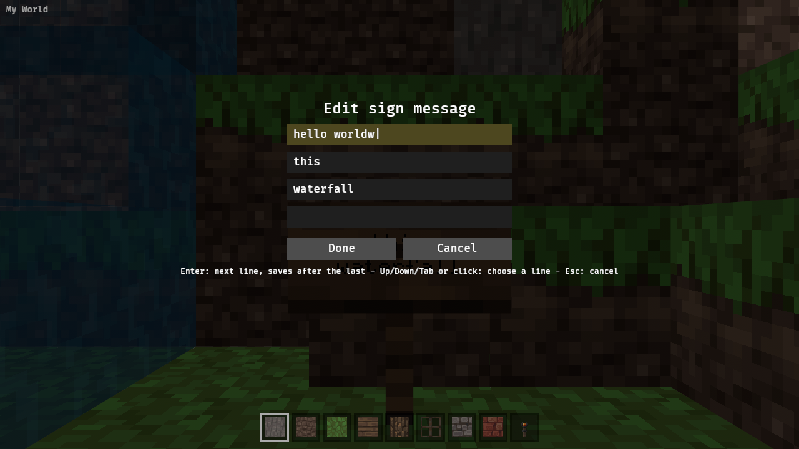
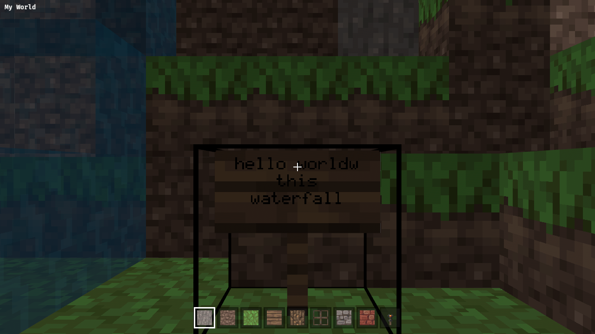

Signs keep their four lines in the `Sign` block entity (`Text1`..`Text4`), which the viewer ignores today.

## Scope

- Render each sign's text on its face (standing and wall signs).
- Right click opens a small editor for the four lines; saving updates the block entity (persisted with the world once saving exists).

## Evidence

Screenshot of the sample world's "waterfall" sign (mcpe2java's test finds 24 signs); edit one and screenshot.

---
▸ 2026-11-01T03:40:06Z [herd]
kind: claim
---

Claim (herd) for worker `sign-1`.

Scope:

- Render each sign's four lines (`Sign` block entity, `Text1`..`Text4`) on its face, standing and wall signs, using the box shapes from mem-12d5. Bevy `Text2d`/world-space text or a baked glyph texture are both fine; record the `Decision:` with the alternative rejected.
- Right click on a sign opens a small editor for the four lines; Enter/Save updates the in-memory block entity and the rendered text; Esc cancels. Pointer lock is released while editing. The block-entity edit should live with the editable world (`world.rs`) so saving (mem-a86b) can pick it up later.
- Another worker (`door-1`, mem-1457) is adding the "right click interacts with interactable blocks instead of placing" rule at the same time. Keep your hook small and clearly separated (one function deciding "sign -> open editor"); the herd will merge the two.
- Out of scope: sign placement with text, colours/formatting.

Judge: herd re-runs the evidence on main.

Evidence:

- Unit test for reading the four lines from block entities.
- `cargo test --workspace`, clippy native and wasm, `sh crates/memcraft-viewer/web/build.sh`.
- Headless screenshot of the sample world's "waterfall" sign (mcpe2java's test finds 24 signs; get its position from the data), then edit one and screenshot.

---
▸ 2026-11-01T03:40:06Z [herd]
kind: move
from: hairy
to: shaving
---

moved: hairy -> shaving

---
▸ 2026-11-01T15:21:48Z [herd]

Runner was wiped again (~11h ago, found Sun Nov  1 15:21:48 UTC 2026); workers door-1/paint-1/sign-1 show no progress since 03:40Z and their runner checkouts are gone. Treating as dead pending Joel's go-ahead to respawn.

---
▸ 2026-11-01T23:40:22Z [sign-2]

Claim (sign-2): taking over from lost sign-1; base a48f18b.

- date: Sun Nov  1 23:40:22 UTC 2026
- farm: /home/user/.local/share/yaks/farms/memcraft/.yaks/mem/yaks/mem-c910.md
- checkout: /home/user/memcraft-5

---
▸ 2026-11-01T23:46:39Z [sign-2]

Decision: sign text is a baked glyph texture on a quad in front of the board, from a small built-in 5x8 ASCII bitmap font (`font.rs`), one entity per sign with text.

- Rejected: Bevy `Text2d`, which renders only through the 2D pipeline (not in this 3D scene), and needs features we cannot add (Cargo.toml is off limits).
- Rejected: Minecraft's own font (not redistributable); drawing text pixels as column-mesh quads (huge meshes, remesh on every edit).
- Cost: monospaced 6 px advance (Minecraft's is proportional), no colours/formatting (`§x` codes are skipped).

Decision: the editor and the menu coexist through a `controls::Modal` flag.

- Opening the editor (`EditSign` message from the right click in `targeting::edit_blocks`) frees the pointer and sets `Modal`; closing locks it again.
- `show_menu` hides the menu while `Modal` is set, `grab_pointer` does not lock on a scene click while it is set.
- The player's input systems already run only while the pointer is locked (`pointer_locked`), so WASD/number keys do nothing while typing.
- Rejected: leaving the menu up behind/over the editor; a separate editor state machine in the menu.

Decision: a block entity is dropped when its cell's block id changes (`WorldMap::set_block`), so a broken sign loses its text and a later save has no orphan. `WorldMap::{block_entity, set_block_entity, take_edited_cells}` are the world-side API (saving reads `col.block_entities`).

Heads-up for the herd: in this checkout `git status` shows `entities.rs`, `item_icons.rs`, `assets/paintings/`, the new textures, and the edits to `main.rs`/`mesh.rs`/`build.rs`/`mcpe-world/src/lib.rs` as uncommitted/untracked on top of a48f18b: the mem-15e6 commits there are empty. My signs code uses `entities::Wall`. I commit only my own files with explicit paths.

---
▸ 2026-11-02T00:07:26Z [sign-2]
kind: checkpoint
commit: 7696d35e8aeb23a0d5af15f68f8479a4f31cf31b
---

Checkpoint: signs.rs/font.rs/sign_editor.rs + world/controls/menu/targeting/main hooks written, 9 sign unit tests pass. Commits 20f31f2 (repair: the paint files a48f18b lacked) and 7696d35 (wip). Next: clippy native/wasm, web build, screenshots.

---
▸ 2026-11-02T00:39:29Z [sign-2]

Summary (sign-2): signs render their four lines and can be edited. Final commit f3952ab (on 7696d35 and 20f31f2, see below).

Shape:

- `font.rs`: 5x8 ASCII bitmap font, `render()` draws four centred lines into a 96x48 RGBA image (one block wide, half a block tall; `§x` codes skipped, other characters show `?`).
- `signs.rs`: reads `Text1`..`Text4` (or one `Text` with newlines), `with_lines()` writes back in the same form keeping other entries. One quad entity per sign with text, in front of the board (standing 63 and wall 68, using the same facing as `blocks::model`). `sync` redraws signs whose cell was edited (`WorldMap::take_edited_cells`).
- `sign_editor.rs`: dialog with 4 lines + Done/Cancel. Typing, Backspace, Enter (next line, saves after the last), Up/Down/Tab, click a line, Esc cancels. 15 characters per line, ASCII only.
- `world.rs`: `block_entity`, `set_block_entity`, `take_edited_cells`; `set_block` drops the block entity when the block id changes.
- `controls.rs`/`menu.rs`: `Modal` flag (see Decision above). `targeting.rs`: 5-line hook sending `EditSign` before the interact rule; `interact.rs` is untouched (lever-1 edits it).
- `main.rs`: `?view=x,y,z,yaw,pitch` page address (wasm only, via `document.url()`), `drive.js`: `VIEW`/`ACTIONS` env, and a pause before the lock click so a mouse jump no longer turns the view.
- README and the menu's Controls help mention signs.

Evidence (all on f3952ab's tree):

- `cargo test --workspace`: all ok, 83 viewer tests, incl. 9 new: four lines read from both forms (`signs::tests::the_four_lines_are_read_from_either_form`), the sample world's 24 signs and the waterfall sign at (14,70,45), text on the front of the board for 4 orientations, break/edit bookkeeping, typing logic, and an App test of open/Esc/save with the pointer lock and `Modal`.
- `cargo clippy --workspace --all-targets -- -D warnings`: clean (EXIT 0).
- `RUSTFLAGS='--cfg getrandom_backend="wasm_js"' cargo clippy -p memcraft-viewer --target wasm32-unknown-unknown -- -D warnings`: clean (EXIT 0).
- `sh crates/memcraft-viewer/web/build.sh`: builds (23M wasm, no wasm-opt on this runner).
- Screenshots, attached: `NODE_PATH=~/tools/drive/node_modules VIEW="14.5,70.9,48.0,180,0" ACTIONS='[...]' node crates/memcraft-viewer/web/drive.js crates/memcraft-viewer/web/dist OUT` -> `sign-text.png` (waterfall sign: "i love / this / waterfall"), `sign-editor.png` and `sign-editor-typed.png` (dialog over the scene, no menu; a pressed `KeyW` typed a "w" and did not move the camera), `sign-edited.png` (text now "hello worldw / this / waterfall"). The run logged: locked after right click: null; after saving: `memcraft`; block edits logged (must be 0): 0.

Known gaps:

- Monospaced font, no colours/formatting, typing is ASCII only (existing non-ASCII text is kept but shown as `?`).
- Standing signs are drawn in quarter turns by `blocks::standing_sign`, so the text follows that, not the 16 angles.
- Saved text is in the block entity only; nothing writes it to disk until mem-a86b/mem-5219.
- Text is not shaded by light.
- Not tested natively (no display here): the editor in a native window, and Done/Cancel/line buttons by mouse (unit-tested only through keys).
- Repo state: a48f18b's mem-15e6 commits were empty; commit 20f31f2 adds the files they should have had (entities.rs, item_icons.rs, paintings, textures, build.rs...). Drop it if the herd has its own fix. `edit_blocks` needs `#[allow(clippy::too_many_arguments)]` now (8 params).

---
▸ 2026-11-02T01:14:24Z [herd-memcraft]

Landed a354d0d on main together with mem-6ad1 (herd merge). Herd re-ran on main: cargo test --workspace (100 viewer tests), clippy native+wasm clean, web/build.sh OK; browser drive logs 'drew the text of 24 of 24 signs'. Merge decisions: sign-2's ?view= replaced by lever-1's ?cam= (same convention); drive.js lost sign-2's VIEW/ACTIONS typing stage, so the editor screenshots are not reproducible from main yet (follow-up). set_block_entity now also marks the column edited so native save writes sign text.

---
▸ 2026-11-02T01:14:25Z [herd-memcraft]
kind: move
from: shaving
to: shorn
thread: ksQQOn_lPggNQrKkBKNvXOzaN5LOADYRe5IBxBCA0aLJyrhJPreUvVwLftHG
---

moved: shaving -> shorn
