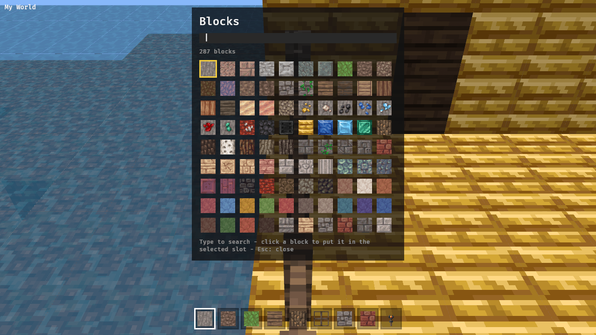
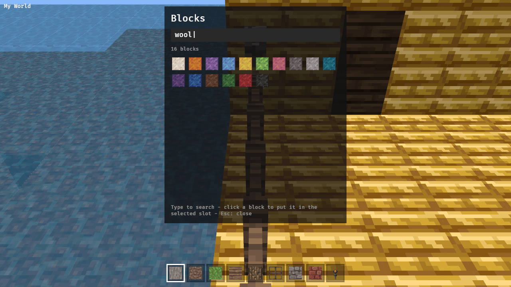
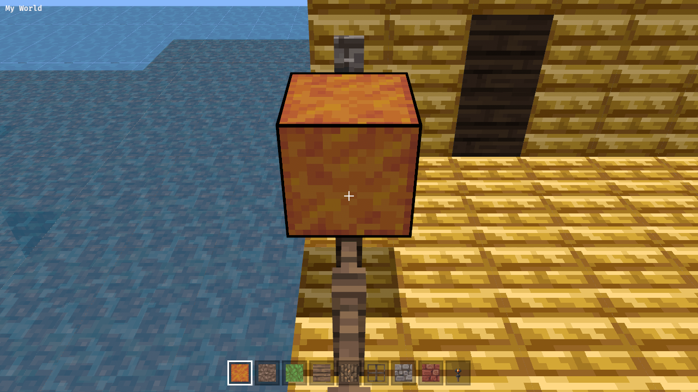

Choose any catalog block for the hotbar.

## Scope

- E opens a panel (releasing the pointer): a text search box and a grid of catalog icons with names on hover; clicking one puts it in the selected hotbar slot; E or Esc closes and the next click relocks.
- Middle click while locked picks the targeted block into the selected slot (pick-block).

## Evidence

drive.js: open the picker, type a search, screenshot the filtered grid; select one, place it.

---
▸ 2026-11-02T01:15:13Z [picker-1]
kind: move
from: hairy
to: shaving
thread: ksQQOn_lPggNQrKkBKNvXOzaN5LOAD2wYpIBxBD-0Otq811F0oo4eGE3HRbr
---

moved: hairy -> shaving

---
▸ 2026-11-02T01:15:13Z [picker-1]

Decision: picker key is B, not E (E is already fly-up with Q). Herd decision.

---
▸ 2026-11-02T01:15:17Z [picker-1]

Started Mon Nov  2 01:15:17 UTC 2026. Checkout: /home/user/memcraft-7. Farm: /home/user/.local/share/yaks/farms/memcraft/.yaks/mem/yaks/mem-d0e5.md. Base a354d0d.

---
▸ 2026-11-02T01:31:56Z [picker-1]
kind: checkpoint
commit: 3bc0e656599d1f59f119fa399cf7677e0b05d201
---

Checkpoint: picker.rs (Bevy UI panel, search, grid, hover tooltip, scroll), middle-click pick-block in targeting.rs, catalog::find/nearest, hotbar tweaks, drive.js PICKER stage written. Unit tests passing being re-run; browser drive evidence still to do.

Decision: key is B (E is fly-up). While the picker is open B is typed into the search (a "birch"/"brick" search needs it), so only Esc closes it; rejected "B toggles", which would make every b-word unsearchable, and "B closes only on an empty query", which still breaks "bricks".

Decision: closing leaves the pointer free and the next click relocks (as the yak says), so the menu shows after Esc; rejected relocking on close like the sign editor, because browsers give no user activation to an Esc keydown and a lock request there can fail.

Decision: pick-block maps the world block to its catalog entry (`catalog::nearest`: exact, then data&7, data&3, then first entry of the id), so a sideways log or a north stair picks the plain catalog block (orientation is mem-b3b2); a block with no entry (lit furnace) picks nothing. Rejected storing the raw world (id,data): upper door halves and double slabs would become unplaceable hotbar blocks.

---
▸ 2026-11-02T02:43:35Z [picker-1]

Finished 2026-11-02 02:44 UTC. Commit 9b0868b on top of a354d0d: block picker (B) with search + middle-click pick-block.
Checks (final tree, rebuilt after target/ was deleted): cargo test --workspace exit 0 (viewer 115 passed, others ok); cargo clippy --workspace --all-targets exit 0, no warnings; cargo clippy -p memcraft-viewer --target wasm32-unknown-unknown exit 0; sh crates/memcraft-viewer/web/build.sh exit 0.
Drive: NODE_PATH=~/tools/drive/node_modules CAM=119.5,67.5,15,180,35 PICKER=wool node crates/memcraft-viewer/web/drive.js crates/memcraft-viewer/web/dist ~/shots-picker1 -> lock null with picker open; 'picked Orange Wool for slot 1'; null after Esc; locked after next click; 'placed (35, 1) at [119, 65, 11]'; middle click 'picked Orange Wool (35:1) from [119, 65, 11]'; block edits logged (must be 1): 1. Screenshots attached (picker-open/search/hover/picked/placed/pickblock). Drive was run on the pre-final-commit dist; the last commit only moved test-only cfg and edited docs/drive comments.
Merge note: main is now c8d53fa; git merge-tree shows conflicts only in main.rs (mod list: picker vs toast / save cfg; add_plugins tuple needs both PickerPlugin and ToastPlugin) and web/drive.js (header comment, edit-count expression: PICKER ? 1 as well as LEVER/SAVE). menu.rs auto-merges.
Known gaps: picker fills only the selected slot (change slot: Esc, click, 1-9, B); Esc leaves menu until a click; pick-block doesn't jump to an existing slot; blocks without catalog entry pick nothing; tooltip has no edge clamping; no keyboard grid navigation.
