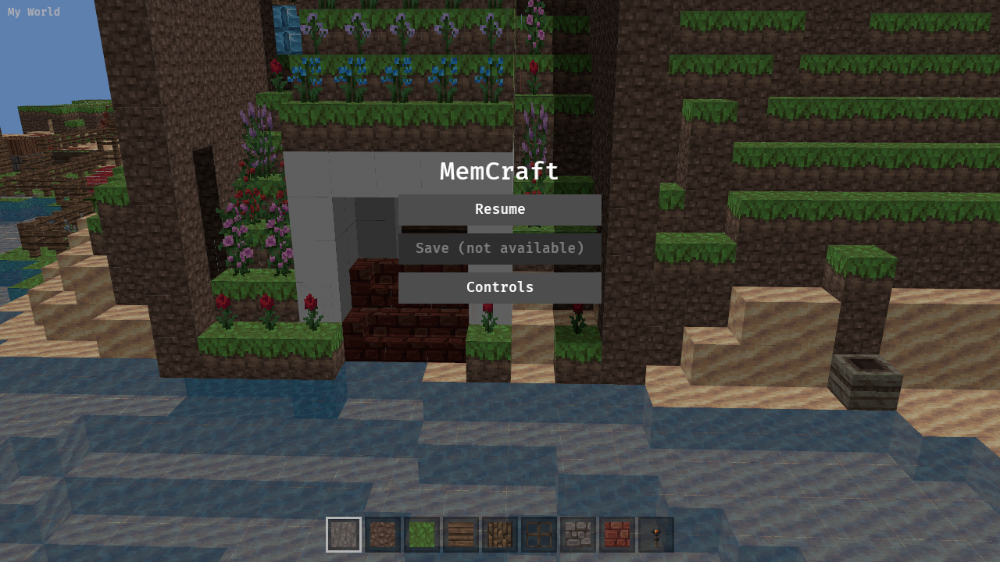
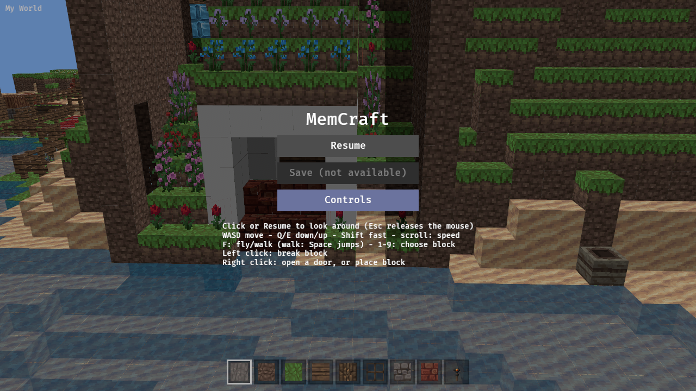
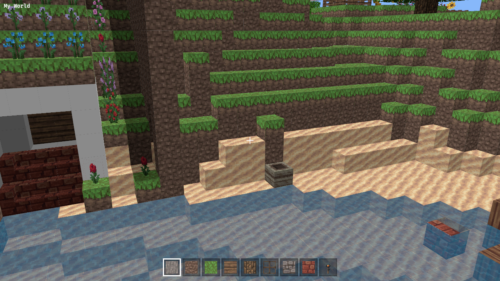
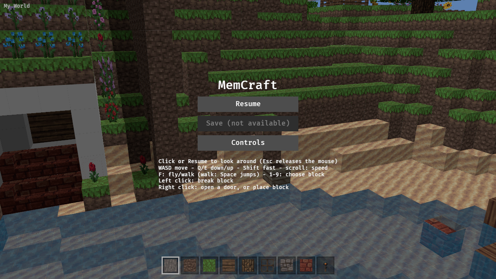

A pause menu, the home for Save and later settings.

## Scope

- Esc releases the pointer (the browser does this regardless) and opens a menu overlay: Resume, Save (disabled until saving exists, or hidden in read-only builds), Controls help.
- Resume (or a click on the scene) relocks the pointer.
- Bevy UI, so native and browser match.

## Evidence

drive.js: Esc shows the menu (screenshot), Resume relocks (pointer-lock state logged).

---
▸ 2026-11-01T15:44:11Z [delta:herd]
kind: claim
---

Claim (delta:herd) for worker `delta:menu-1`. Bevy UI only (Joel, mem-4fcd answer 3).

Scope:

- A pause menu that appears whenever the pointer is unlocked (Esc, lost focus, browser releasing lock), and hides when the pointer is locked again. Today's "click to lock" behaviour becomes a "Resume" button plus click-on-world-to-resume; the click that resumes must not break or place (keep tgt-1's guard).
- Items for now: Resume; a short controls help panel (move the current help text there if it lives elsewhere in the UI; keep README in sync); a disabled/placeholder "Save" entry with a clear hook (an event or a `MenuAction` enum) that mem-5219 will wire up. No settings yet.
- Movement/look/targeting/hotbar keys are ignored while the menu is open.
- Small module `menu.rs`, minimal changes to `controls.rs`/`main.rs`. Workers on doors (`targeting.rs`, new `interact.rs`) and paintings (`entities.rs`) are active; avoid editing their files.
- Out of scope: Save itself, settings, block picker.

Judge: delta:herd re-runs the evidence on main.

Evidence:

- `cargo test --workspace`, clippy native and wasm, `sh crates/memcraft-viewer/web/build.sh`.
- Headless screenshots: menu visible before locking; hidden after clicking Resume (pointer locked); visible again after `document.exitPointerLock()`; record that the resume click made no edit.

---
▸ 2026-11-01T15:44:11Z [delta:herd]
kind: move
from: hairy
to: shaving
---

moved: hairy -> shaving

---
▸ 2026-11-01T15:44:51Z [delta:menu-1]

Start Sun Nov  1 15:44:50 UTC 2026; checkout /home/user/memcraft-5 (git toplevel), base 48ed523

---
▸ 2026-11-01T15:46:57Z [delta:menu-1]

Progress: menu.rs written (Bevy UI overlay open whenever pointer unlocked; Resume/Save(disabled, SaveAvailable+SaveRequested hook)/Controls), controls.rs gates keys with pointer_locked and grab_pointer ignores clicks on UI, hotbar gated, HUD help text moved into menu, README updated. Next: tests, clippy, web build, drive.

---
▸ 2026-11-01T22:09:39Z [herd-memcraft]

menu-1 lost with the runner before completing. Respawning as menu-2 from main 0a53ca6.

---
▸ 2026-11-01T22:14:51Z [menu-2]

menu-2 start: checkout /home/user/memcraft-3, base 0a53ca6, wip commit 6762cae (menu.rs, pointer_locked gating in controls/hotbar, drive.js menu steps, README). Next: tests, clippy, web build, drive run.

[menu2-drive](mem-d6f2/menu2-drive.log)

---
▸ 2026-11-01T23:05:13Z [menu-2]

Decision: buttons are detected through `Interaction` on `Button` inside `grab_pointer` (ignores the LOCK click while any button is hovered/pressed), not UI picking or backdrop observers: one rule, same on native and web.
Decision: no Esc-to-close. Browsers don't deliver Esc while the pointer is locked and can't relock from an Esc keydown; Resume or a scene click closes the menu. Uniform native/web.
Decision: Save is shown greyed as "Save (not available)" rather than hidden. `SaveAvailable(bool)` resource + `SaveRequested` message are the hook for mem-5219; no saving implemented.
Decision: movement/physics (walk gravity too) pauses while the menu is open: look/toggle_mode/scroll/fly/walk and hotbar keys are gated with `.run_if(pointer_locked)`.
Decision: menu hangs at fixed 200 px top padding so toggling the help text doesn't shift the buttons (centered layout made Controls clicks miss).
Done: commit d128447 on main (local, not pushed; wip commits 6762cae ab491a5 a1a7434). Files: menu.rs (new), controls.rs, hotbar.rs, main.rs, web/drive.js, README.md.
Checks: cargo test --workspace all ok (viewer 66 passed); cargo clippy --workspace --all-targets and clippy -p memcraft-viewer --target wasm32-unknown-unknown: 0 warnings. web/build.sh ok. Playwright drive.js (TMPDIR=/tmp): locked before click null; after Controls click null; after left click memcraft; after exitPointerLock null; after Resume memcraft; block edits logged 0. Screenshots attached.
Gaps: no Esc-to-close; Save is only a hook; drive.js button coordinates assume 1280x720 and the 200 px offset; Resume click relies on edit_blocks running before grab_pointer. Not shorn: herd shears.
