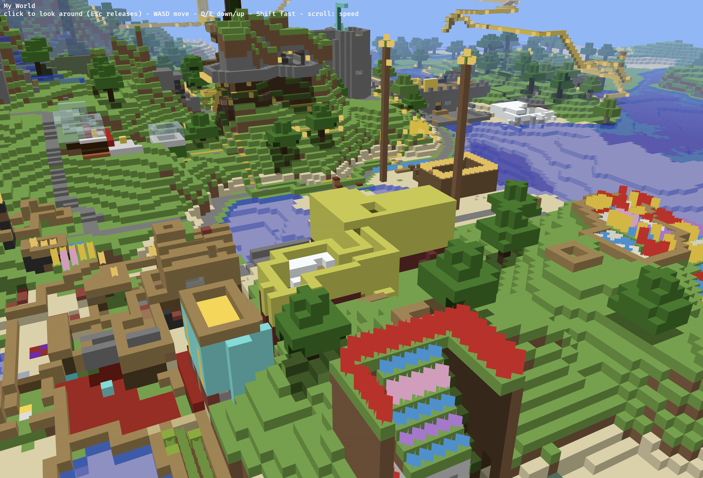

Route A works (mcraft.fun plays the converted world). Remaining reasons for our own client: PE look and feel, no dependence on a third-party site, and a full Rust stack. `mcpe-world` already builds for wasm32 and is the starting point. Needs a decision before work starts: textures (Mojang's can't be redistributed; options are an openly licensed pack or the user supplies one), and scope (fly-through vs walk/edit).

---
▸ 2026-10-29T03:56:32Z [delta:Start investigation for yak mem-0908]

joelgwebber (Delta comment): "let's try it" — look for a low-effort path to a basic fly-through; suggested Bevy (verify its wasm target).

---
▸ 2026-10-29T03:56:32Z [delta:Start investigation for yak mem-0908]

moved: hairy -> shaving

---
▸ 2026-10-29T11:56:33Z [Joel Webber]

Off to a great start! Native and web builds work beautifully out of the box.

