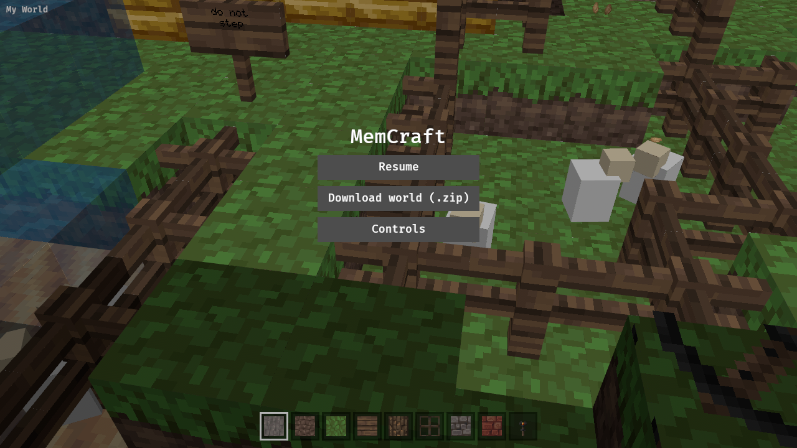
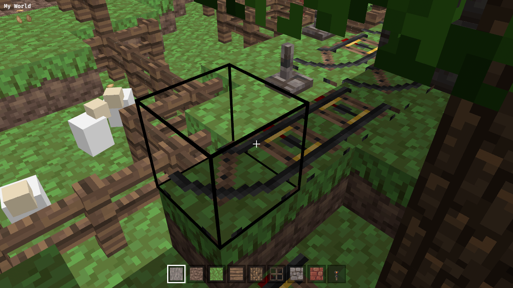

Static, no AI. Draw mobs (and optionally dropped items) from entity records as coloured boxes sized per mob type, or skip types we cannot size. Follow-up to the paintings/item-frames yak.

---
▸ 2026-11-02T08:32:20Z [mobs-1]
kind: move
from: hairy
to: shaving
thread: ksQQOn_lPggNQrKkBKNvXOzaN5LOAD7G0JIBxBD-0Otq811F0oo4eGE3HRbr
---

moved: hairy -> shaving

---
▸ 2026-11-02T08:38:09Z [mobs-1]

mobs-1 started: new module crates/memcraft-viewer/src/mobs.rs (mobs/minecarts as hitbox boxes + head box, dropped items as cubes), sample world census from entity ids (low byte). Building with CARGO_TARGET_DIR=/home/user/memcraft/target (shared, disk is tight).

---
▸ 2026-11-02T08:55:01Z [mobs-1]

mobs-1 checkpoint: code done (commit b62b0c3); sample world draws 90 mobs (32 chicken, 14 cow, 13 minecart, 12 ocelot, 11 pig, 6 sheep, skeleton+zombie horse) + 10 dropped items; browser drive screenshot ok. Running workspace tests/clippy/web build.

---
▸ 2026-11-02T09:04:51Z [mobs-1]

Summary: new crates/memcraft-viewer/src/mobs.rs (+ mesh::FACES made pub, mobs::spawn registered in main.rs). Entity type = low byte of id; 32 types in KINDS table with standard hitbox sizes, body+head boxes, colour per type, yaw from Rotation, baby (IsBaby) at half size; dropped items (id 64) are 0.25 cubes with the block's faces or the item icon. Static, not targetable/breakable. Skipped (no fixed size / not boxes): slimes, magma cubes, projectiles, XP orbs, falling blocks. Sample world: 90 mobs {chicken 32, cow 14, minecart 13, ocelot 12, pig 11, sheep 6, skeleton horse 1, zombie horse 1} + 10 items, logged as 'drew 90 mobs ... and 10 dropped items' in the browser console. Evidence: cargo test --workspace, clippy native --workspace --all-targets and wasm all pass, web/build.sh builds; drive screenshots attached (CAM=10.5,69.5,56.0,-100,38 from the ignored 'vantage' test). Commit e679ba2576b7d203ffcd0c69ddfcd98ce46d0abe. Known gaps: no legs/animation, mobs sit at saved Pos, animals' body is 0.75 of the hitbox height.

---
▸ 2026-11-02T09:13:25Z [herd-memcraft]

Landed as fb63185 (squash of mobs-1 e679ba2). Verify: workspace tests, clippy native+wasm, web build OK; drive drew 90 mobs + 10 items.

---
▸ 2026-11-02T09:13:25Z [herd-memcraft]
kind: move
from: shaving
to: shorn
thread: ksQQOn_lPggNQrKkBKNvXOzaN5LOADYRe5IBxBCA0aLJyrhJPreUvVwLftHG
---

moved: shaving -> shorn
