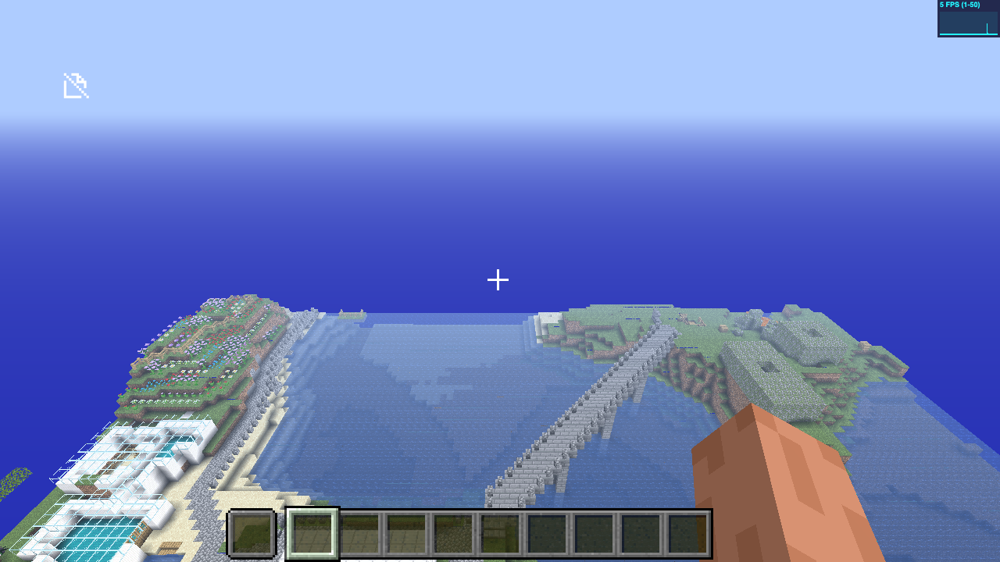
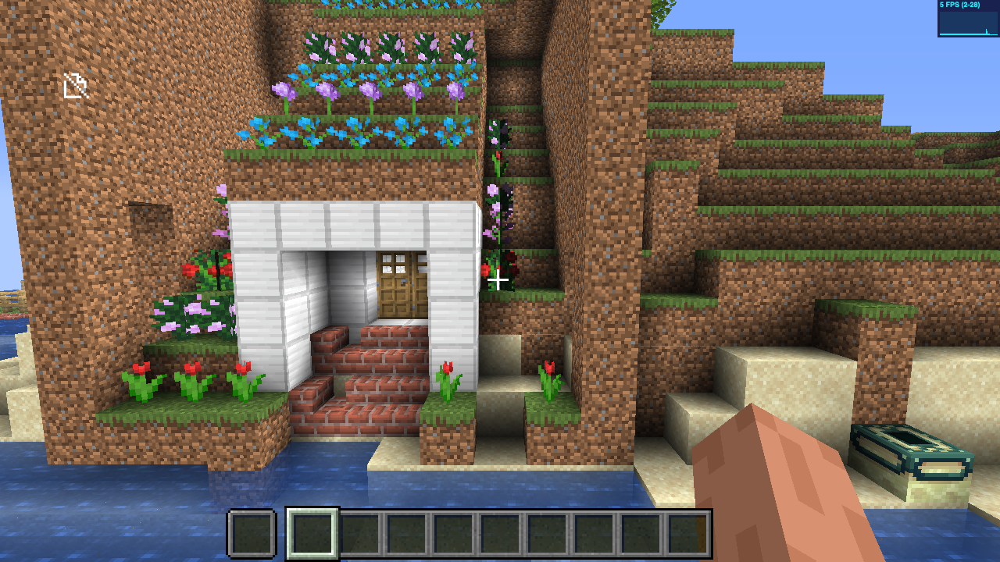
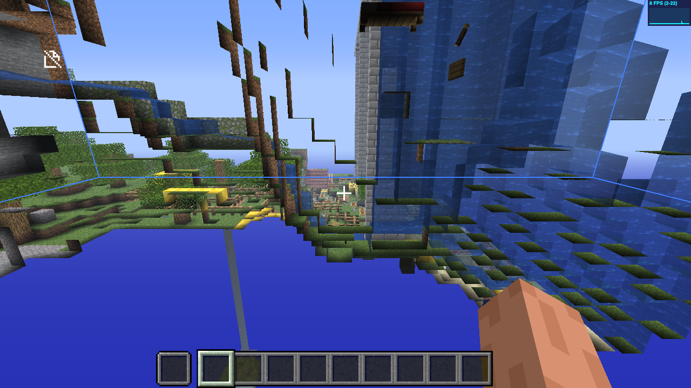

---
▸ 2026-10-29T01:59:03Z [delta:Start investigation for yak mem-0908]

moved: hairy -> shaving

[mcraft-drive](mem-ef1e/mcraft-drive.js)

---
▸ 2026-10-29T02:33:05Z [delta:Start investigation for yak mem-0908]

## Result: My World is playable in mcraft.fun

The converted zip loads via `https://mcraft.fun/?map=<zip url>`. The client logs "All chunks done and ready" about 4–9 s after connect, in creative mode, with the 1.12.2 resource pack.

Screenshots from headless Chrome via Playwright (the script, `mcraft-drive.js`, is attached and serves the zip through `page.route`):

- `view-overview.png`: the whole 256×256 island from the south. Terrain, water, trees, gold-block builds, the world border.
- `view-saved.png`: the house at the player's saved position (45, 66, 233). Correct quartz, brick stairs, door, flowers, ender chest; normal lighting.
- `view-waterfall.png`: north-west area; water, fences, rails.

Bug found and fixed (`c84f23a`): looking past the world edge threw `ENOENT r.0.-1.mca`, because the browser's read-only zip filesystem can't create missing regions. The converter now writes empty neighbour regions.

## Known gaps and follow-ups

- **Spawn position.** The client spawns players at world spawn (128, 64, 128), not the saved `Player.Pos`. It ignores level.dat's Player when the username differs. Easy fix: set `SpawnX/Y/Z` to the player position.
- **Hosting.** `?map=` needs a CORS-enabled URL. A GitHub release asset or Pages would do; this means the world becomes public.
- **Automation quirk.** In this client only the first `/tp` per session took effect, so each view needed a fresh page load. It doesn't matter for humans.
- Rendering through SwiftShader ran at about 5–8 FPS. A real GPU will be fine.
- Not converted: item frames (block → entity), mobs, piston heads, the cauldron.

---
▸ 2026-10-29T02:33:05Z [delta:Start investigation for yak mem-0908]

moved: shaving -> shorn
