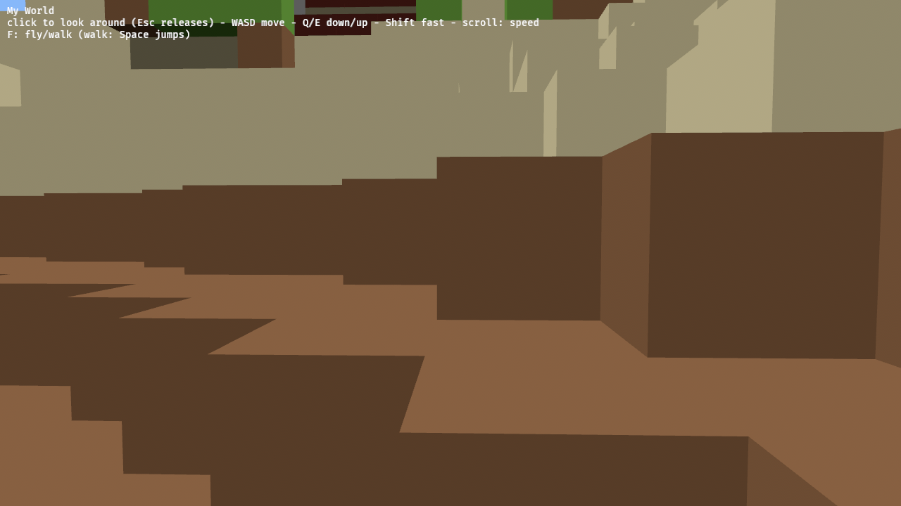
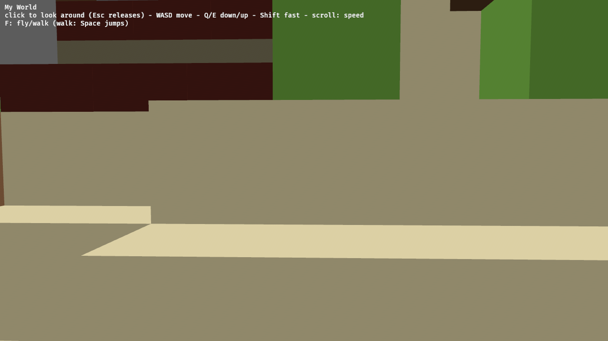
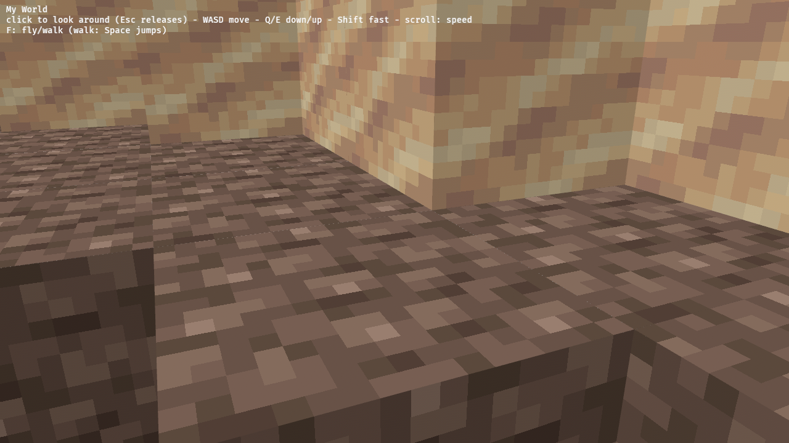

This is a decent sized chunk of work, and the first crack at collision detection. So let's take the time to build it carefully, using existing bevy crates where helpful. Consider carefully whether it's worth doing "real" physics, or hacking something together the way the original MC did.

If one of the bevy physics crates can be used largely OOTB, without being obscenely expensive, perhaps that would be better than playing "physics whack-a-mole" with a more hand-crafted solution.

---
▸ 2026-10-29T17:19:38Z [delta:Set up remote yak workflow]

moved: hairy -> shaving

---
▸ 2026-10-29T17:19:38Z [delta:Set up remote yak workflow]

Claim (yakherd: this thread). Owner: worker `walk-1`.

- Scope: `crates/memcraft-viewer/src/controls.rs` (extend the controller with a walk mode and a fly/walk toggle), a new collision/physics module in the viewer, `main.rs` only to register it, `Cargo.toml` if a physics crate is adopted, README controls line.
- Out of scope: `blocks.rs`, `mesh.rs` rendering (owned by `mem-7aba`), except reading `blocks::look` shapes for solidity.
- Evidence: unit tests for collision (falling onto ground, not walking through a wall, stepping/jumping up one block), headless browser run showing the player standing on terrain and walking, wasm size before/after.
- Judge: the yakherd at landing. The physics-crate-vs-hand-rolled choice is a `Decision:` note with numbers.

---
▸ 2026-10-29T17:22:17Z [walk-1]

Started: 2026-10-29T17:20Z (`date -u`, walk-1).
`yaks path mem-f13a`: /home/user/.local/share/yaks/farms/memcraft/.yaks/mem/yaks/mem-f13a.md

Plan: (1) measure physics-crate cost vs hand-rolled (baseline wasm size/build time first), (2) Decision note, (3) implement in new `physics.rs` + `controls.rs`, tests, browser run.

---
▸ 2026-10-29T17:54:52Z [walk-1]

Decision: hand-rolled Minecraft-style AABB-vs-voxel sweep, not a physics crate. Rejected: avian3d 0.7.0 (spiked), bevy_rapier3d 0.36.0 (not built; same shape of problem). Real numbers (17:3x-17:5x Z, this 8-core runner, wasm-release profile, same Bevy 0.19.1):

- Compatibility: crates.io deps show avian3d 0.7.0 -> bevy ^0.19.0 and bevy_rapier3d 0.36.0 -> bevy ^0.19.0 (+rapier3d 0.35); avian3d 0.8 / bevy_rapier3d 0.37 / bevy_tnua 0.33 need Bevy 0.20 (not buildable on our rustc 1.95-era pin). So both work with 0.19.1, avian with default-features=false features 3d,f32,parry-f32. I built a working spike (static `Collider::voxels` of the whole world + kinematic cuboid + `MoveAndSlide`) and it compiled first try.
- Wasm size: baseline 22,250,036 B (after wasm-opt -Oz); with avian3d + spike 25,793,246 B = +3.54 MB (+15.9%) for a feature that needs ~300 lines. Cargo.lock +579 lines (obvhs, parry3d, glamx, bevy_heavy, ...). Cold wasm-release build 7m35 -> 8m16 (+~40 s; bevy was rebuilt both times because avian turns on extra bevy features).
- Feeding it the terrain: world is 256 columns, 4,362,243 full cubes. Per-block colliders is a non-starter. Whole-world `Collider::voxels`: all 4.36M cubes build in 236 ms native release (surface-only: 232,668 voxels, 31 ms + 528 ms to collect them, which is slow because it queries 6 neighbours per block via World::block). wasm is typically 2-4x slower, so ~0.1-1 s of added startup, plus memory for the BVH/voxel grid on top of our meshes. A trimesh of the ~300k quads would be worse (BVH over 600k triangles).
- What it does NOT give: voxel colliders are full cubes only, so slabs/snow/carpet (`Shape::Partial`) would be solid cubes or non-solid; no "unloaded column = wall" (player walks off the edge and falls forever), and no auto step-up (MoveAndSlide slides only; step-up, ground detection and jump still hand-written, i.e. the whack-a-mole is only moved, not removed). Also a full solver pipeline (PhysicsPlugins, spatial-query BVH sync in FixedPostUpdate) runs for one kinematic body.
- Why hand-rolled wins: the world already IS a grid; solidity is one lookup `blocks::look(id,data).shape`. Sweeping a 0.6x1.8x0.6 box one axis at a time (Y, X, Z, MC order) touches ~10-30 cells per call, can't tunnel at any speed, handles Partial heights exactly, and makes chunk-boundary behaviour trivial (one lookup function, no seams between colliders). Cost: 0 added dependencies, ~1 byte/block (4 MB RAM for 256 columns... see physics.rs `Solids`) and a few hundred lines + unit tests.
- Would reconsider a crate if we later need dynamic bodies, mobs-vs-mobs, projectiles or non-axis-aligned shapes.

---
▸ 2026-10-29T18:35:15Z [walk-1]

Decision: fly stays the default; F toggles fly/walk (on-screen hint and README updated). Rejected: starting in walk mode (the start view is 4 blocks up and 8 back from the saved player, so it would drop the camera on load); Tab/double-tap-Space as toggle (F is one key, no timing logic).

Decision: unloaded columns and everything below y=0 count as solid (`Solids::height`), above y=127 is air. Rejected: treating unloaded as air (the player walks off the edge of the finite world and falls forever; tested by `the_world_edge_and_bottom_are_walls`).

Decision: liquids (ids 8-11) are not solid and there is no swimming: you sink through water and lava to the bottom. Rejected: adding swim physics here (a separate feature; `Shape::Translucent` covers water and glass alike, so water needs an id check, which `Solids::from_world` does). Follow-up yak candidate: swimming/drag.

Decision: `Solids` is a compact one-byte-per-block copy of the world (sixteenths of block height, from `blocks::look`), inserted as a Bevy resource at setup, not a kept `mcpe_world::World` and not a closure over it. Rejected: querying `World::block` + `look` per cell (needs the whole World with light/NBT kept alive; 256 columns x 32 KiB = 8.4 MB for ours, correcting my earlier "4 MB" estimate in the crate Decision). Building it adds one pass over all 4.4M blocks at startup, same order of cost as `sky_heights`.

Decision: feel constants are Minecraft's: gravity 32 b/s^2, terminal 78 b/s, jump 9.0 b/s (peaks ~1.27 blocks: clears one block, not two; tested), auto step-up 0.6 (slabs/carpet/snow walk up, full blocks need a jump), walk 4.3 / sprint (Shift) 5.6 b/s, box 0.6 x 1.8, eyes 1.62. Horizontal velocity follows the keys instantly (also in the air). Rejected: acceleration/friction/air-control model (more tuning, not asked for).

Decision: frames are simulated in <=1/60 s substeps and a frame longer than 0.1 s is cut to 0.1 s (a stall or hidden tab can't drop you through the floor or teleport you; the cost is slow motion below 10 fps, which is what the headless SwiftShader run shows). Collision sweeps are exact per axis, so even 500 b/s into a one-block-thin wall can't tunnel (tested).

Decision: toggling into walk while inside terrain lifts the player in 0.25 steps to the first free spot above; if there is none (e.g. inside an unloaded column) the toggle is refused and the player keeps flying. Rejected: letting you walk while embedded (stuck forever) and always refusing (surprising when flying through a hill). Scroll still scales speed in both modes (`scroll_speed` split out of `fly`); rejected: fly-only, since the hint says "scroll: speed" without a mode.

---
▸ 2026-10-29T18:35:15Z [walk-1]

Evidence (walk-1, 2026-10-29 ~18:35Z):
- Shape: new `physics.rs` (`Solids` voxel grid, `Aabb`, `Body::step`: Y then X then Z sweep, step-up, jump); `controls.rs`: `Mode {Fly, Walk}`, `Controller` gets mode/body/walk+sprint speed, systems `toggle_mode`, `scroll_speed`, `fly` (now mode-gated), `walk`; `main.rs`: `mod physics`, `Solids` inserted in setup, hint line, doc comment; README controls line. Pointer-lock code untouched. No Cargo changes. `blocks.rs`/`mesh.rs` untouched.
- Tests: `cargo test --workspace` all green; 13 new physics tests incl. falls and lands, long frames/terminal velocity no tunnelling, wall blocks (and diagonal slides), thin wall at 500 b/s, one-block jump but full block not walkable, two blocks is a wall, slab auto-step up and down, ceiling bump, chunk-seam crossings (x=16,z=16,x=0,z=0, astride a seam over a one-sided floor), world edge/bottom, `is_free`, and `lands_on_the_real_terrain_everywhere` (~thousands of drops from y=127 into the embedded world across all chunk seams: never ends below the surface or inside terrain).
- clippy `--workspace --all-targets -D warnings` native and `-p memcraft-viewer --target wasm32-unknown-unknown` (RUSTFLAGS getrandom cfg): clean.
- wasm (build.sh, after wasm-opt -Oz): before 22,250,036 B, after 22,270,954 B = +20,918 B (+0.09%). For comparison avian3d spike: 25,793,246 B.
- Headless browser (SwiftShader; script at ~/base/drive-walk.js on the runner, a copy of web/drive.js with F toggles that read position from an info! log line): fly start eye (45.2,71.0,240.7); F -> falls and lands at eye y=59.6 (feet 57.98, i.e. standing on a surface 58); holding W alone moves 1.4 blocks then is stopped by a one-block ledge (45.2,59.6,240.7 -> 44.7,59.6,239.3); holding W+Space climbs the terraces to (44.4, 63.6, 230.3). Screenshots attached: 2-walk-landed.png (standing on dirt terraces looking at the horizon), 3-walk-moved.png (after hopping up a sand/stone staircase).
- Note: headless frames take seconds, and a frame simulates at most 0.1 s, so walks are slow-motion in the screenshots run (small viewport used while walking).

---
▸ 2026-10-29T18:35:24Z [walk-1]

Correction: 14 new physics tests (not 13); 18 viewer tests total... see log: 17 in the viewer crate incl. 1 controls + mesh/blocks ones. Commit aa4b60d.

---
▸ 2026-10-29T18:35:24Z [walk-1]

moved: shaving -> shorn

---
▸ 2026-10-29T18:42:04Z [delta:Web Deploy v0]

Landed on origin/main as ae787b0 (cherry-picked onto the texture work; README conflict merged). Re-verified there: cargo test --workspace pass (viewer 17), clippy -D warnings native + wasm clean, wasm 22.56 MB, drive.js pointer lock lock/release/relock correct, F->walk + W/Space screenshot attached.
