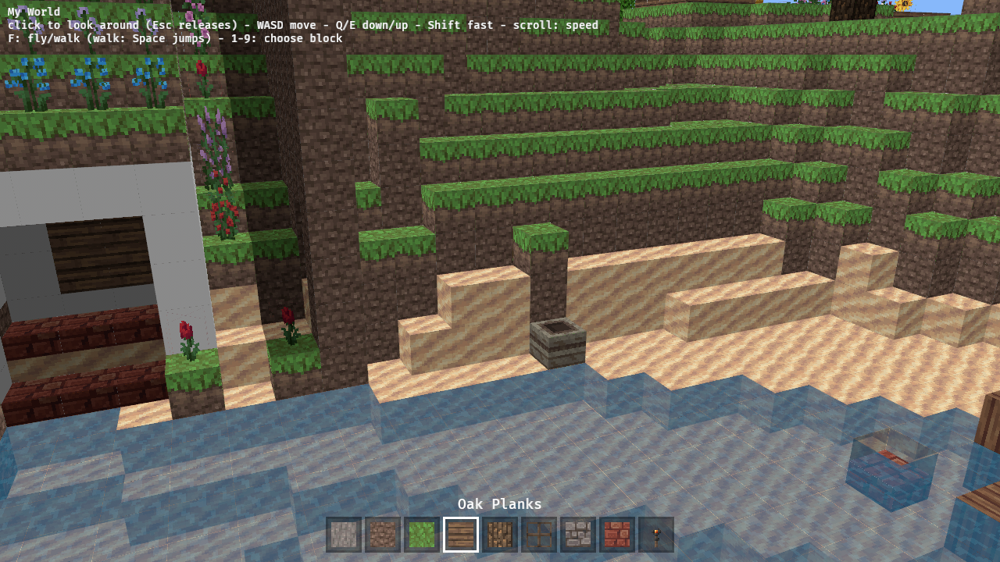

A Minecraft-style hotbar: 9 slots at the bottom centre with block icons, a highlight on the selected slot, the selected block's name shown briefly on change.

## Scope

- Renders the shared `Hotbar` resource; number keys 1-9 select. Scroll wheel too, if the input question on the parent yak goes that way.
- Icons from the atlas tile of each block (catalog, or `blocks::look` until the catalog lands).
- Sensible default slots (stone, dirt, grass, planks, log, glass, cobblestone, brick, torch).

## Evidence

Screenshot via drive.js with a non-default slot selected; works in the browser and native builds.

---
▸ 2026-11-01T01:59:30Z [herd]
kind: move
from: hairy
to: shaving
---

moved: hairy -> shaving

---
▸ 2026-11-01T01:59:31Z [herd]

Claim: worker `hot-1` (Delta subthread), base `8fc3164`.

- Scope: `hotbar.rs` (keep the `Hotbar` type's public shape: `slots`, `selected`, `selected_block`) and its plugin registration in `main.rs`. Icons via `catalog` (`Entry::icon`, names) and the atlas.
- Number keys 1-9 only. Scroll is pending Joel's answer on `mem-4fcd`: don't touch `controls.rs`.
- Out of scope: targeting/placing (`tgt-1`), the picker.
- Evidence: drive.js screenshot with a non-default slot selected (keys via `KEYS`), unit test for selection.
- Judge: yakherd at landing.

---
▸ 2026-11-01T02:01:11Z [hot-1]

Start: Sun Nov  1 02:01:11 UTC 2026. Farm path: /home/user/.local/share/yaks/farms/memcraft/.yaks/mem/yaks/mem-f4f7.md. Checkout: /home/user/memcraft-5, base 8fc3164.

---
▸ 2026-11-01T02:26:59Z [hot-1]

Progress: hotbar.rs plugin written (spawn_ui, select_by_key, refresh_slots, show_name), main.rs registers HotbarPlugin and inserts an `AtlasImage` resource, help line and README updated. `cargo test -p memcraft-viewer`: 29 passed (incl. 4 new hotbar tests). Clippy native/wasm and web build running.

Decision: icons use `ImageNode` with a per-tile `rect` on the shared atlas image, not a `TextureAtlasLayout`. Rejected: a layout asset (one more asset + resource for a plain grid; rect needs only `blocks::atlas` consts).

Decision: the atlas handle reaches the hotbar through a small `AtlasImage` resource in main.rs, and the UI spawns in `PostStartup`. Rejected: ordering a Startup system `.after(setup)` (hotbar would name main's private `setup`); a second `images.add(atlas_image())` (duplicates the atlas in memory).

Decision: no name popup on the first frame (it only records the starting selection). Rejected: showing slot 1's name at launch (noise).

---
▸ 2026-11-01T02:44:47Z [hot-1]

Evidence (all run in /home/user/memcraft-5, base 8fc3164 plus my edits):

- `cargo test -p memcraft-viewer`: 29 passed, 0 failed (hotbar::tests::number_keys_select_slots, other_keys_leave_the_selection, describes_catalog_and_other_blocks, default_slots_all_have_icons).
- `cargo clippy -p memcraft-viewer --all-targets -- -D warnings`: exit 0. Same with `--target wasm32-unknown-unknown`: exit 0.
- `sh crates/memcraft-viewer/web/build.sh`: exit 0 (22M wasm).
- `KEYS='[["Digit4",100]]' NODE_PATH=~/tools/drive/node_modules node crates/memcraft-viewer/web/drive.js crates/memcraft-viewer/web/dist $TMPDIR/out`: ran; attached moved.png shows slot 4 (oak planks) with the white border and "Oak Planks" above the bar. Caveat: drive.js printed "locked after left click: null" and a pageerror "A user gesture is required to request Pointer Lock" in this headless run, so pointer lock was never taken; the key event still reached the app (selection changed), and I did not investigate the lock further (controls.rs is out of scope).
- Caveat: the name is 2 s of game time (virtual clock, capped per frame); under SwiftShader frames are slow, so the 3 s wait in drive.js still caught it. On a fast machine the name would already have faded at that moment.

---
▸ 2026-11-01T02:44:54Z [hot-1]

Summary: hotbar UI as HotbarPlugin (9 slots, atlas-tile icons, selected border, 1-9 keys, 2 s name popup); main.rs registers it and exposes AtlasImage; help line and README updated; scroll/controls.rs untouched. Screenshot attached (hotbar-slot4.png).

---
▸ 2026-11-01T02:44:54Z [hot-1]
kind: move
from: shaving
to: shorn
---

moved: shaving -> shorn

---
▸ 2026-11-01T02:44:58Z [hot-1]
kind: checkpoint
branch: wip/hot-1
commit: 53f8c84e60638178b30aa425ea0edcb567e9a376
---

checkpoint

---
▸ 2026-11-01T02:45:49Z [herd]
kind: landed
commit: cdfc2d25190cd17ddac175a3eb7d3ba5c14ab468
source: 53f8c84e60638178b30aa425ea0edcb567e9a376
branch: main
---

landed: cdfc2d2 mem-f4f7: hotbar UI plugin with icons, number-key selection and block name

---
▸ 2026-11-01T02:59:07Z [herd]

Yakherd re-verified on main `cdfc2d2` (pushed): `cargo test -p memcraft-viewer` 29 pass, clippy -D warnings native + wasm clean, web build OK, screenshot shows slot 4 / Oak Planks. Pointer lock did not engage in headless runs at load ~12-25 (other workers building); the live site, which passed this test earlier, fails the same way under the same load, so it is a test-environment timing issue (the lock request lands after the click's ~5 s user activation), not a regression.
